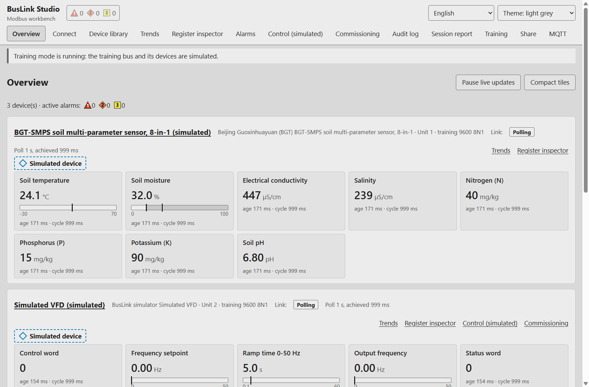
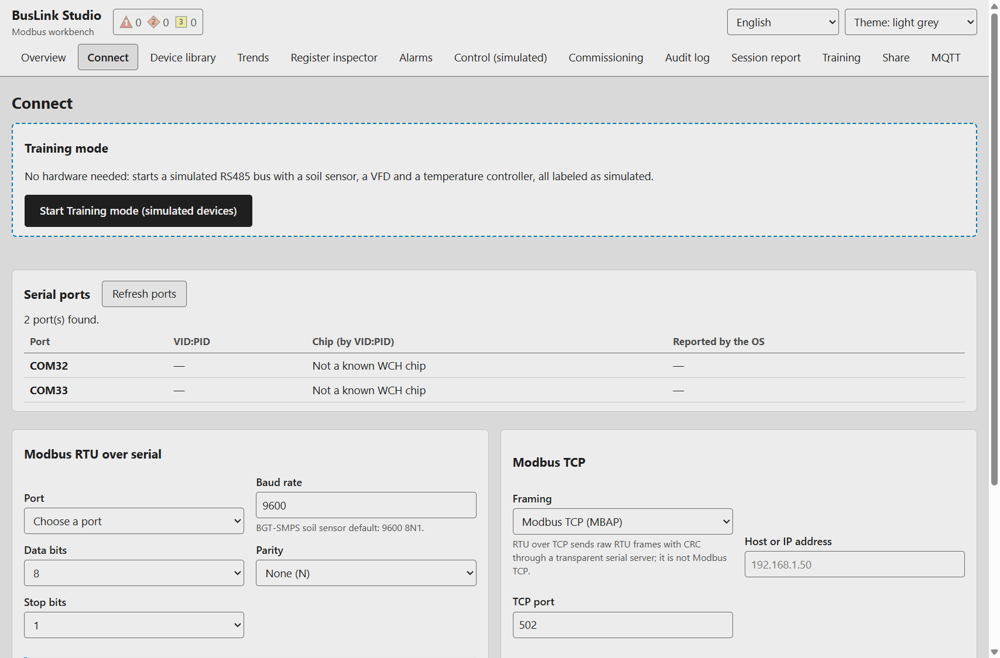
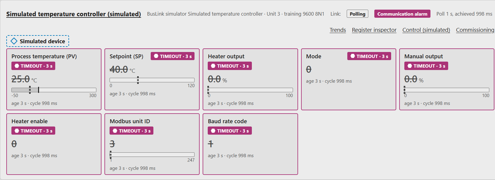
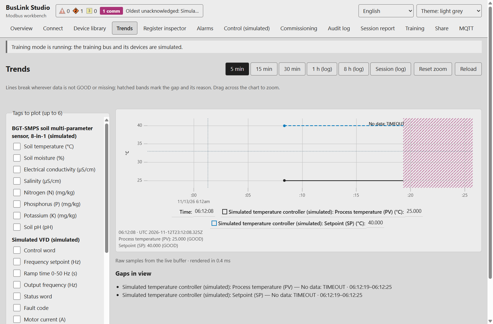
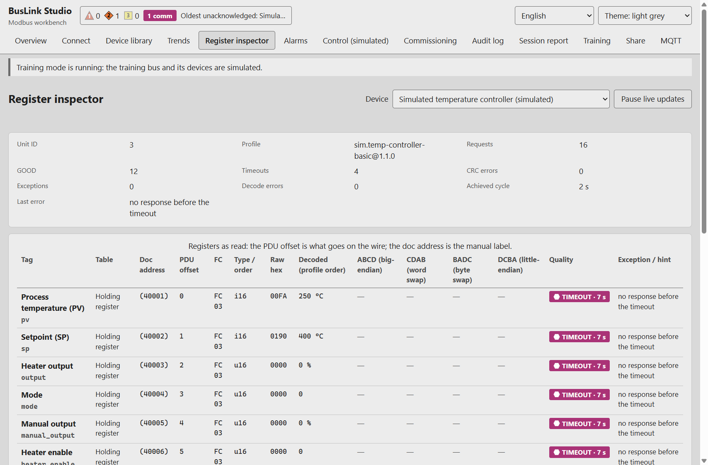
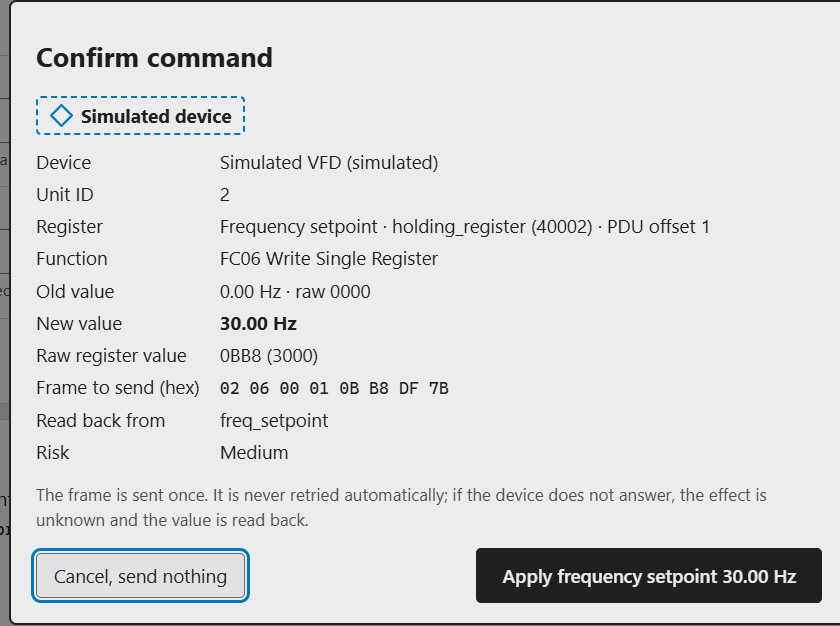
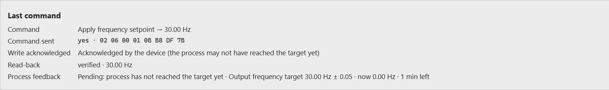
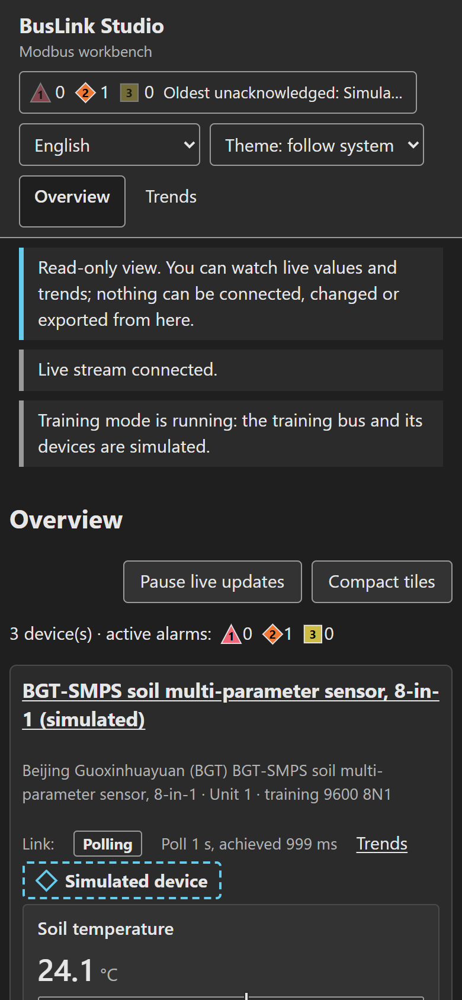

# BusLink Studio

One open Modbus workbench for laptop, phone and browser. Read an RS485 or Modbus TCP device on Windows, plug the same USB adapter into an Android phone through USB-C OTG, and share a read-only dashboard over the LAN. The same device profile is used everywhere.

Built for **Kiroween 2026** (category: Frankenstein) with Kiro. Every feature came from a Kiro spec; see [How Kiro was used](#how-kiro-was-used).

> **Status, stated plainly.** All automated checks run against the built-in simulator. The Windows app was driven end to end on Windows. The Android APK builds, but it has **not yet run on a phone with a real sensor**: the procedure and the empty result sheet are in [`docs/verification/android-hardware.md`](docs/verification/android-hardware.md).

**User and technical manual (PDF):** [English](docs/manual/buslink-manual-en.pdf) · [Bahasa Indonesia](docs/manual/buslink-manual-id.pdf). Markdown versions: [EN](docs/manual/buslink-manual-en.md) · [ID](docs/manual/buslink-manual-id.md).



## What it does

- **Live dashboard** that follows high-performance HMI rules (ISA-101 style): grey when normal, colour only for abnormal states. Analog bars use the profile's declared range only.
- **Quality on every value.** Each value carries GOOD, TIMEOUT, CRC, EXCEPTION, STALE, DECODE_ERROR or DISCONNECTED, plus its age. A stale value is struck through and never shown as fresh.
- **Trends that break at gaps.** Missing data is never interpolated, and the chart names the reason ("No data: TIMEOUT").
- **Register inspector**: manual address, PDU offset, raw bytes, and all four word orders side by side, with the frame log.
- **Guarded writes.** You arm the device, the value is checked against the profile bounds (rejected, never clamped), you confirm the exact frame, and the app sends it once, reads it back and writes an audit row. Control is enabled only for the simulated devices in this release.
- **Commissioning wizard** for unit ID and baud changes, with read-back and a recovery path.
- **Android USB OTG** through usb-serial-for-android (CH343, CH340/CH341, CP210x, FTDI), with a `connectedDevice` foreground service and export through the system file picker.
- **LAN dashboard**: read-only and off by default. It binds to a private IPv4 address only, uses a per-session TLS certificate and a 128-bit token, and serves GET routes only.
- **MQTT telemetry**: MQTT 5 over TLS, publish only, with a bounded SQLite outbox replayed in order. The password is stored in the OS credential store, never in project files.
- **Exports**: CSV, XLSX and JSON with quality, exception code, age and profile version, plus a printable session report and the audit log.
- **Training mode**: a multi-device simulator (soil sensor, VFD, temperature controller, energy meter) with fault injection: timeout, CRC error, exception and wrong word order.
- English and Bahasa Indonesia UI, light and dark themes, and a layout that works down to 360 px.

## Quick start (no hardware needed)

**Windows installer:** download `BusLink-Studio_0.1.1_x64-setup.exe` from [Releases](../../releases/latest) (SHA-256 in `SHA256SUMS.txt`), install it, then open **Connect → Start training mode**. The installer is unsigned, so SmartScreen may warn: choose *More info → Run anyway*.

**From source** (Rust 1.85+, Node 20+, Windows for the desktop shell):

```bash
npm ci
npm run tauri dev          # desktop app
cargo test --workspace     # core, simulator and session tests
npm test                   # UI unit tests
```

Android build notes: [`docs/android-build.md`](docs/android-build.md).

### Real hardware

A USB to RS485 adapter (tested target: WCH CH343G, `1A86:55D3`, not isolated), the device's own power supply, A/B and GND wired, and 120 Ω termination at both bus ends. Only one Modbus master may poll a bus at a time. Profiles live in [`profiles/`](profiles); the schema is in [`docs/profiles/schema-v1.md`](docs/profiles/schema-v1.md).

## How to use it (5 minutes, no hardware)

All screenshots are from the real Windows app in Training mode, so every device shown is simulated. The full step-by-step guide with 25 figures is in the manual above.

**1. Connect.** Open **Connect** and press **Start Training mode (simulated devices)**. A simulated RS485 bus starts with a soil sensor (unit 1), a VFD (unit 2) and a temperature controller (unit 3). For real hardware, use **Refresh ports**, choose the port and the serial settings from the device manual, and press **Connect serial link**. Then add the device from the **Device library**.



**2. Read live values with their quality.** **Overview** shows one card per device. Each tile has the value with its unit, an analog bar (only when the profile declares a range), the data **age** and the poll cycle. Grey means normal.

| Quality | Meaning |
|---|---|
| GOOD | The device answered and the value decoded |
| TIMEOUT | No answer in time: the last value is kept but struck through, and its age keeps growing |
| CRC_ERROR | The reply was corrupted on the wire |
| EXCEPTION | The device answered with a Modbus exception, for example 02 Illegal Data Address |
| STALE | No new data within about 3× the poll interval |
| DECODE_ERROR / DISCONNECTED | The raw value broke the profile rules / the link is not polling |



**3. Practise faults.** **Training** injects a timeout, CRC error, exception 02, frozen values or wrong word order into one simulated unit. Each fault ends by itself. The guided exercises on the same page explain what each fault should teach.

**4. Trends break at gaps.** In **Trends**, the line stops wherever data is not GOOD, and a hatched band names the reason. Nothing is interpolated.



**5. See the bytes.** **Register inspector** shows the manual address next to the PDU offset that goes on the wire (40001 = offset 0), the raw hex, all four word orders for 32-bit values, and the last request/response frames.



**6. Write safely (simulated VFD).** Open **Control (simulated)**, type your name and press **Arm control for this device**. Arming ends after 60 s without activity. A value outside the profile bounds is rejected next to the field. A valid value opens a dialog showing the exact frame, including the CRC. After **Send**, the app checks the device's acknowledgement, reads the register back and checks the process feedback. Every step lands in the **Audit log**.

| Confirm the exact frame | Acknowledged, read back, verified |
|---|---|
|  |  |

**7. Share or publish.** **Share** serves a read-only view to browsers on the same LAN, protected by a private address, a per-session certificate and a token. The viewer has no connect, arm or write controls. **MQTT** publishes telemetry only and never subscribes.



**8. Keep a record.** On **Overview**, export CSV, XLSX or JSON with quality, exception code and age on every row. **Session report** prints a commissioning record.

The software stop **is not an emergency stop**. Writes are enabled only for the simulated devices in this release.

## Architecture

```
crates/buslink-core   Modbus RTU/TCP codec, scheduler, quality, alarms, historian (SQLite),
                      command service, exports, LAN server (axum), MQTT (rumqttc)
crates/buslink-sim    multi-device simulator with fault injection (training mode)
src-tauri             Tauri 2 shell: IPC, Windows serial, Android USB bridge
plugins/tauri-plugin-buslink-usb   Kotlin USB serial plugin + foreground service
src                   TypeScript UI (no framework), shared by the app and the LAN view
```

All Modbus write encoding lives in `crates/buslink-core/src/command/`. A Kiro hook blocks write function codes anywhere else.

## Verification

| Check | Result |
|---|---|
| `cargo test --workspace` | 274 passed |
| `npm test` | 37 passed |
| Journey 1, dashboard / timeout / trend gap / export (Windows, e2e build) | 15/15 |
| Journey 4, arm / confirm / read-back / audit (simulated VFD) | 30/30 |
| Journey 3, LAN share / token / read-only / stop | 38/38 |
| Android APK on Samsung A35 + CH343G + soil sensor | **not run yet** |

Details, screenshots and method: [`docs/verification/README.md`](docs/verification/README.md). Property-based tests use a seeded generator, and any failure prints its seed for replay.

## Security

The security review was done by a read-only Kiro agent ([`docs/security/review-07.md`](docs/security/review-07.md)). It found no critical or high issues, 2 medium and 6 low. Fixes, and the three items accepted with reasons, are in [`docs/security/review-07-fixes.md`](docs/security/review-07-fixes.md). Roles are a safety interlock, not authentication: [`docs/security/roles.md`](docs/security/roles.md). The software stop **is not an emergency stop**.

## How Kiro was used

- **Specs:** seven specs in [`.kiro/specs/`](.kiro/specs) (core-protocol, simulator, app-shell-desktop, dashboard-ui, commissioning-control, android-otg, lan-mqtt). Each has EARS requirements, a design with correctness properties, and tasks that were ticked only when their checks passed.
- **Steering:** [`.kiro/steering/`](.kiro/steering) covers product, tech, Modbus facts, safety rules, UI rules and Android.
- **Hooks:** [`.kiro/hooks/`](.kiro/hooks):
  - a write-path guard that blocks FC05/06/15/16 code outside the command service;
  - a profile schema check;
  - tests on save for the core;
  - a type check for the UI;
  - a verify step on stop.
- **Custom agents:** [`.kiro/agents/`](.kiro/agents):
  - `buslink-builder`, which implements the specs;
  - `ics-security-reviewer`, which may only run `git diff` and `git show` and cannot write files;
  - `hmi-designer`;
  - `profile-author`.
- **Session log:** [`docs/kiro-log/`](docs/kiro-log). Every Kiro CLI run is recorded with its prompt, session ID, tools used and result, including the runs that hit a time limit and were resumed.

Planning artifacts (product brief, PRD, architecture, epics) are in [`docs/bmad/`](docs/bmad).

## Pre-existing work

This project was started on 11 Nov 2026. Earlier projects by the same author were read for facts and lessons only, and no code was copied. Everything adopted is listed in [`docs/existing-code-disclosure.md`](docs/existing-code-disclosure.md). Third-party libraries are listed in [`THIRD_PARTY_NOTICES.md`](THIRD_PARTY_NOTICES.md).

## License

Apache-2.0. See [`LICENSE`](LICENSE).
