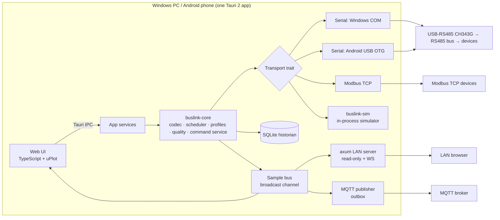

# BusLink Studio: architecture (BMAD phase 3)

Covers the PRD requirement IDs (R1–R24, N1–N6). Technical facts are from `research/03-platform-tauri-android-usb.md`.

## Context


## Repository layout
```
crates/buslink-core/   # protocol (RTU/TCP framing, CRC), codec, profile schema + validation,
                       # scheduler (one queue per link), quality, alarms, command service, historian, export
crates/buslink-sim/    # deterministic simulator: soil sensor, VFD, temperature controller, energy meter; fault injection
src-tauri/             # Tauri shell: IPC commands, transports (Windows serial, Android USB), LAN server, MQTT
src-tauri/gen/android/ # generated Android project + Kotlin USB permission / FGS
src/                   # web UI (TypeScript, Vite), shared by the desktop window, Android WebView and LAN browsers
profiles/              # bundled device profiles (JSON) + schema
video/                 # Remotion demo video project
docs/                  # BMAD, design, verification, Kiro evidence
```

## Key decisions
| # | Decision | Alternatives | Why |
|---|---|---|---|
| D1 | **Own RTU/TCP framing in `buslink-core`**, reusing `rmodbus`-style pure codec ideas; no async transport crate in core | tokio-modbus | Core stays sync and testable with a fake transport (property tests on CRC/framing). Length-based RTU parsing (from FC and byte count) is robust against USB fragmentation on Android (research/03 risk table). |
| D2 | **Transport trait** `open/configure/read(timeout)/write/flush/close` + detach event; implementations for Windows serial (`serialport`), Android USB (Kotlin usb-serial-for-android 3.12 via a Tauri mobile plugin, bytes bridged over JNI), TCP (std net), simulator (in-memory) | tauri-plugin-serialplugin 4.2 on both | The plugin is young (4 months). Our own Kotlin path is the proven pattern from the owner's earlier Android work. The trait lets us swap. |
| D3 | **One worker thread per link** owns the transport; requests go through an mpsc queue with priorities (commands > alarms > polling); per-device backoff | async tasks | Matches "one master per bus" (R4). Blocking serial I/O stays off the tokio runtime. |
| D4 | **Sample bus** = `tokio::sync::broadcast` of `Sample{device, tag, raw, value, unit, quality, age_ms, ts_source, ts_rx, seq, profile_version}` consumed by UI, historian, LAN, MQTT | each consumer polls | One source of truth; every consumer sees identical quality. |
| D5 | **uPlot** for trends | ECharts, Chart.js | Small (~50 KB), fast for 100k+ points, supports null gaps natively. Final choice confirmed against research/02. |
| D6 | **LAN server = axum** on the Tauri tokio runtime, bound to a chosen interface, self-signed cert per session (rcgen), token in URL/QR, only GET + WS routes | Tauri localhost plugin (no Android) | R22. There are no write routes at all, so nothing to misconfigure. |
| D7 | **MQTT: plain JSON topics `buslink/{site}/{gw}/{device}/{tag}`** in the MVP; Sparkplug B later | Sparkplug B now | Sparkplug's protobuf/birth/death adds a lot for a phone gateway. Plain topics + seq + quality meet R23. Revisit after the MVP. |
| D8 | **Command service** state machine: `Idle → Armed(timeout) → Previewed(frame) → Confirmed → Sent → ReadBack → Done/Failed`, single attempt, audit row per transition | direct writes | N1/R18. The only code path that may emit FC05/06/15/16 (enforced by a Kiro hook). |
| D9 | **Historian**: SQLite WAL, batch inserts every 1 s, logging interval ≥ polling interval, min/max/avg rollups per minute for long trends | raw only | R20 and N3 (big ranges load quickly). |
| D10 | **Android targetSdk 36**, minSdk 24, `connectedDevice` FGS started after USB permission | API 37 | Avoids the Android 17 local-network permission until it is handled (research/03). |
| D11 | Windows packaging: NSIS with WebView2 bootstrapper + portable exe; Android arm64 APK (debug-signed for the hackathon) | MSI | NSIS works from our toolchain; MSI is not required. |

## Data model (historian)
`sessions(id, started, app_version, platform)` · `devices(id, session, profile_id, profile_version, unit_id, link)` · `tags(id, device, key, unit)` · `samples(tag, ts_rx_ms, ts_src_ms, seq, raw BLOB, value REAL, quality INT, age_ms)` · `events(ts, kind, device, tag, severity, text)` · `commands(id, ts, device, fc, address, requested, encoded_hex, response_hex, readback, state, user_note)` · `outbox(seq, topic, payload, tries)` · rollups `samples_1m(tag, minute, n, min, max, sum)`.

## Security (N2)
- **Threat surfaces:** the write path, LAN server, MQTT credentials, imported profiles/CSV, USB permission.
- **Controls:**
  - A Kiro hook blocks write function codes outside `command/` and the simulator.
  - The LAN server has no write routes.
  - Profiles are data validated by JSON Schema (no expressions or scripts).
  - CSV export has a formula guard.
  - Secrets are kept in the OS keychain / Android Keystore.
- **Default posture:** LAN and MQTT off until the user enables them.

## Test strategy
- **Unit and property tests in `buslink-core`:**
  - CRC known vectors.
  - Encode→decode round trip for all FCs.
  - Decoder never panics on random bytes.
  - All word orders.
  - Quality transitions.
  - Command state machine.
  - Scheduler fairness with one dead device.
- **Simulator integration tests:** multi-device poll, fault injection, gap rendering data.
- **UI:** `tsc` + a headless Chrome check of the five acceptance journeys.
- **Hardware:** an evidence matrix (Windows + CH343G + BGT-SMPS; Android A35 + OTG + BGT-SMPS).
