# About this manual

BusLink Studio is an open Modbus workbench for commissioning, maintenance and training. It reads RS485 (Modbus RTU) and Ethernet (Modbus TCP) devices. It runs on Windows and on Android phones (through a USB-C OTG adapter), and it can share a read-only dashboard with any browser on the same network. One **device profile** describes each device model, and the same profile file works on every platform.

This manual has two parts:

- **Part A, user guide:** installing the app, connecting, reading values, trends, alarms, guarded writes, commissioning, exports, LAN sharing, MQTT and training mode.
- **Part B, technical reference:** architecture, quality model, safety rules, the profile format, security design, verification and limits.

> **Status of this release.** Every screen in this manual was captured from the real Windows app (version 0.1.0) running **Training mode**, so all devices shown are simulated. The Android build compiles, but it has not yet been tested on a phone with a real sensor. Control commands are enabled only for the simulated devices in this release.

## Who it is for

| Person | Typical task |
|---|---|
| Field technician | Wire a new sensor, check that it answers, and read live values with their quality and age |
| Commissioning engineer | Set a device's unit ID or baud rate, and prove the change with a read-back |
| Maintenance engineer | Find why a value is wrong: a timeout, an exception, the word order or the scale |
| Supervisor | Watch a live, read-only dashboard from a browser |
| Trainer or student | Practise faults safely with the built-in simulator |

## Conventions

- **Bold** names a button, menu item or field exactly as the app shows it.
- `Code` marks file names, values and frames as they appear on the wire.
- *Unit ID* is the Modbus slave address (1–247 on serial, 1–255 on TCP). **0 (broadcast) is never used.**

# Part A · User guide

## 1. Install and start

### 1.1 Windows

1. Download `BusLink-Studio_0.1.0_x64-setup.exe` from the GitHub release page (<https://github.com/Wayan123/buslink-studio/releases/latest>). You can check the file against `SHA256SUMS.txt` on the same page.
2. Run the installer. It is not signed yet, so Windows SmartScreen may show "Windows protected your PC". Choose **More info → Run anyway**.
3. Start **BusLink Studio** from the Start menu.

Requirements: Windows 10 or 11 (x64) with WebView2, which Windows 11 includes. No administrator rights are needed to read devices.

### 1.2 Android (preview)

The arm64 debug APK is built from source (see `docs/android-build.md`). Android 7.0 (API 24) or newer is required. The app needs USB host support and a USB-C OTG adapter. The test procedure for a phone with a real sensor is in `docs/verification/android-hardware.md`.

### 1.3 From source

```
npm ci
npm run tauri dev           # desktop app
cargo test --workspace      # Rust tests
npm test                    # UI tests
```

## 2. The screen at a glance


| Area | What it shows |
|---|---|
| Header, left | App name and the **alarm counter**: priority 1 (red triangle), 2 (orange diamond) and 3 (yellow square). The shape matters, not only the colour. |
| Header, right | Language (**English** / **Bahasa Indonesia**) and **Theme** (system, light grey, dark). |
| Navigation bar | **Overview, Connect, Device library, Trends, Register inspector, Alarms, Control (simulated), Commissioning, Audit log, Session report, Training, Share, MQTT** |
| Banner | Status notices, such as "Training mode is running" or "Sharing on the network". |
| Device cards | One card per device: name, model, unit, link settings, link state, poll rate and tiles. |

The dashboard follows high-performance HMI practice (ISA-101): **grey means normal**, and colour appears only when something needs attention. Normal values are never shown in green.

## 3. Connect a link

Open **Connect**.

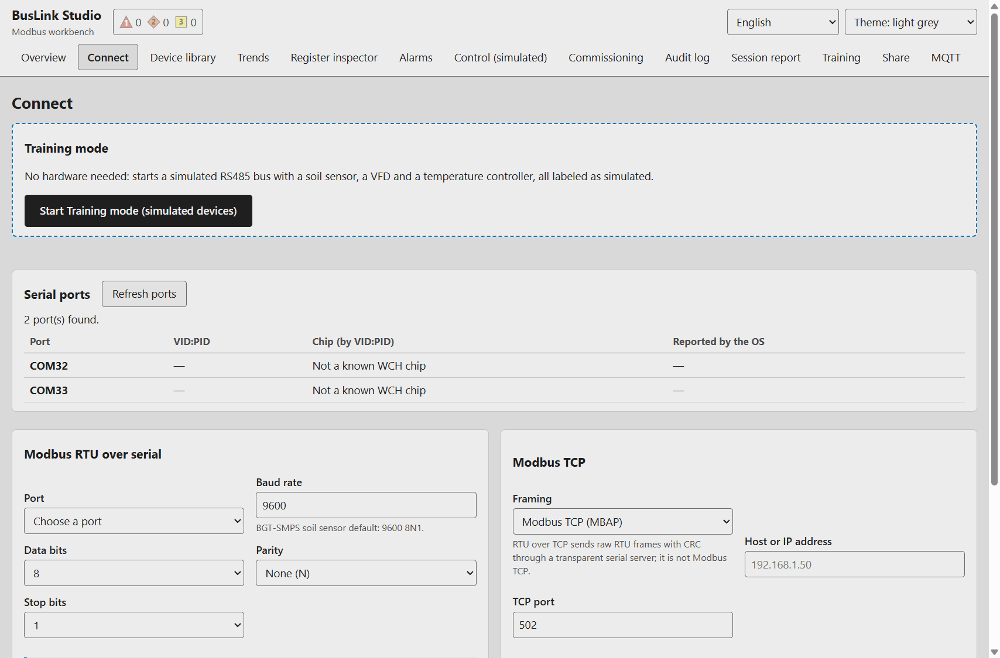

A **link** is one communication path: a serial port or a TCP connection. One link can carry several devices with different unit IDs.

### 3.1 Training mode (no hardware)

Press **Start Training mode (simulated devices)**. The app starts a simulated RS485 bus with three devices, each labelled "Simulated device":

| Unit | Device | Main values |
|---|---|---|
| 1 | BGT-SMPS 8-in-1 soil sensor | temperature, moisture, EC, salinity, N, P, K, pH |
| 2 | Variable-frequency drive (VFD) | control word, frequency setpoint, ramp, output frequency, current, status |
| 3 | Temperature controller | PV, SP, output, mode |

An energy meter (unit 4) can be added from the **Device library**.

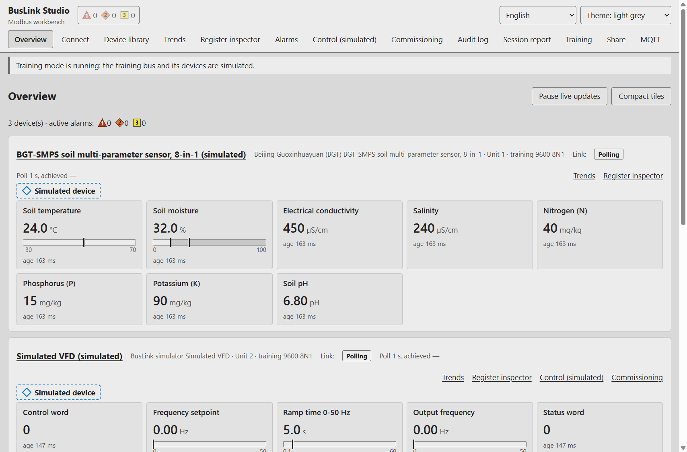

### 3.2 Modbus RTU over serial (RS485)

1. Plug in the USB-RS485 adapter and press **Refresh ports**. The table lists each port with its VID:PID and, for WCH chips, the chip name. For example, `1A86:55D3` is a WCH CH343.
2. Choose the **Port** and set **Baud rate**, **Data bits**, **Parity** and **Stop bits** to match the device manual. The soil sensor default is 9600 8N1.
3. Press **Connect serial link**.

**Wiring checklist:**

- Connect A+ to A+, B− to B− and GND to GND.
- Use twisted-pair cable and daisy-chain the devices. Do not wire a star.
- Fit 120 Ω termination at both ends of the bus.
- Power the device from its own supply, never from the USB port.
- Only **one master** may poll a bus at a time, so close other Modbus tools first.
- The Waveshare USB TO RS485 (B) adapter is **not isolated**. For field work, use an isolated adapter.

### 3.3 Modbus TCP

Choose a **Framing**:

- **Modbus TCP (MBAP)** for normal Ethernet devices and gateways (port 502).
- **RTU over TCP** for transparent serial servers that forward raw RTU frames with CRC. This is not the same as Modbus TCP.

Enter the **Host or IP address** and the **TCP port**, then press **Connect TCP link**. On Wi-Fi, *client isolation* on the access point can block the connection.

## 4. Add a device from the library

Open **Device library**.

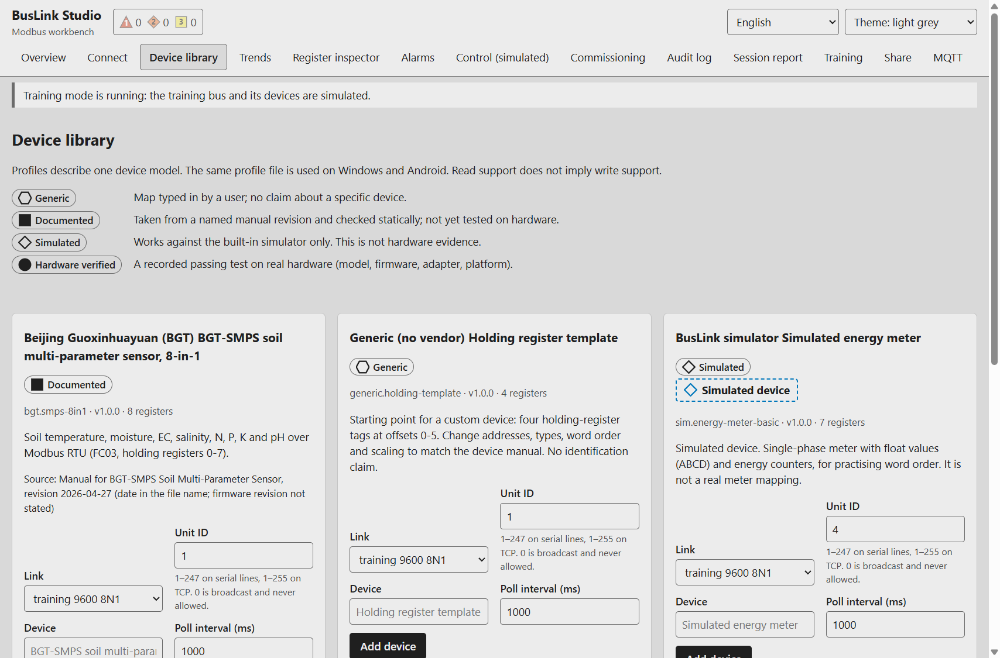

1. Find the device model and check its source document and revision.
2. Choose the **Link**, enter the **Unit ID** and the **Poll interval (ms)**. The interval can be 100 ms to 24 h.
3. Press **Add device**, then start polling for the link on **Connect**.

Support level matters: read support does not imply write support. A profile only allows writes that it declares, with bounds.

## 5. Read live values

### 5.1 Tiles

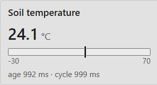

Each tile shows:

- **Name** and **value with its unit**, using the decimals the profile sets.
- **Analog bar**. It appears only when the profile declares a range (`valid_range` or `display_range`). The shaded band is the normal range and the ticks are alarm limits. If the value goes outside the range, the marker is clamped to the end and the tile says "Out of scale".
- **age**: the time since this value was last read successfully.
- **cycle**: the poll period actually achieved.

### 5.2 Quality: what each label means

Every value carries a quality. Only **GOOD** values are shown as current.

| Quality | Meaning | What the tile does |
|---|---|---|
| GOOD | The device answered and the value decoded | Normal grey tile |
| TIMEOUT | The device did not answer in time | Badge; last value kept but **struck through**; age keeps growing |
| CRC_ERROR | The reply was corrupted on the wire | Badge; last value struck through |
| EXCEPTION | The device answered with a Modbus exception (for example 02 Illegal Data Address) | Badge with the exception code |
| STALE | No new data within the stale threshold (about 3× the poll interval, at least 3 s) | Badge; value struck through |
| DECODE_ERROR | The raw value broke the profile rules | Badge |
| DISCONNECTED | The link is not polling | Badge |

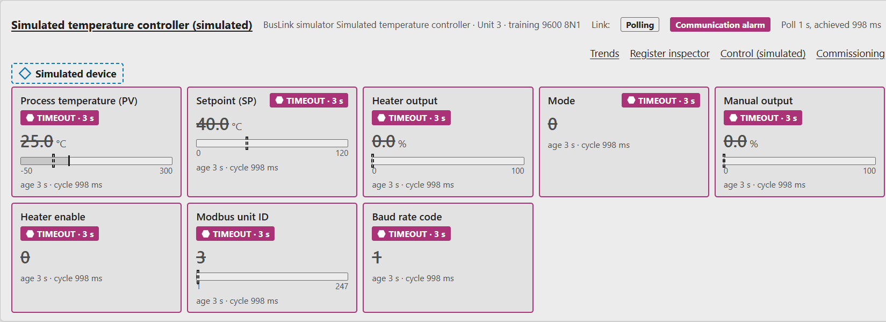

A missing reply **never** becomes 0 or a fresh value. Other devices on the same link keep polling.

### 5.3 Alarm banner


The banner counts active alarms by priority and names the oldest unacknowledged one. Click it to open **Alarms**.

## 6. Trends

Open **Trends** and pick a device, or use the **Trends** link on its card.

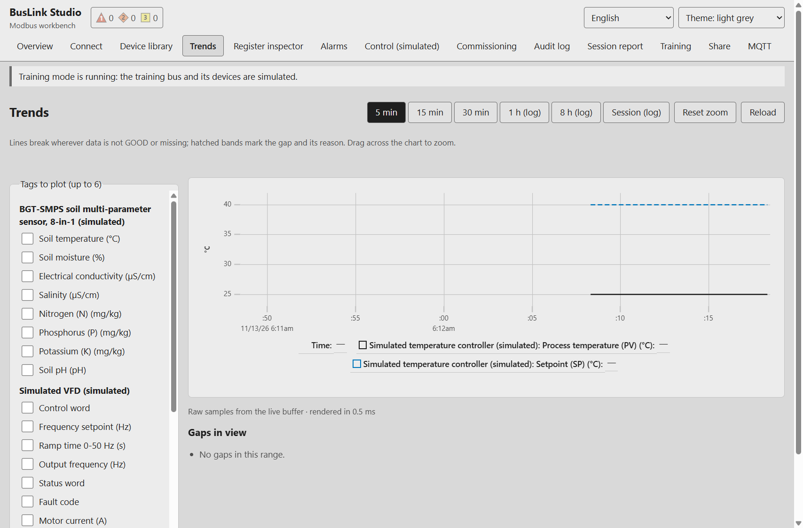

- **Time range:** 5, 15 or 30 minutes from the live buffer, or 1 h, 8 h or the whole session from the log.
- **Tags to plot:** pick one or more tags (there is an upper limit).
- **Drag** across the chart to zoom, then press **Reset zoom** to return.

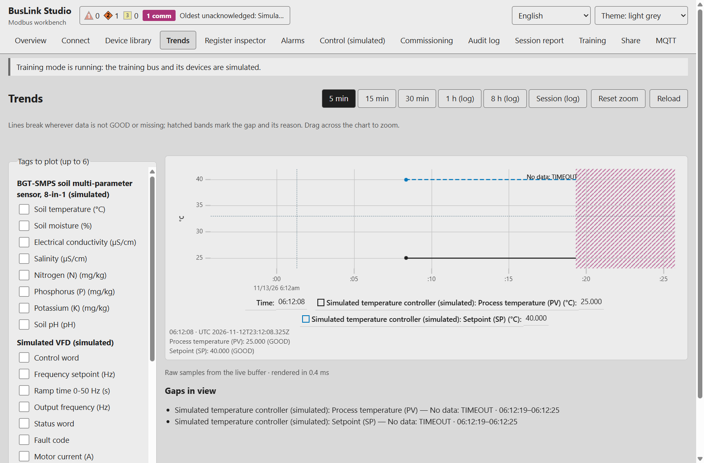

Lines **break wherever data is not GOOD**. Nothing is interpolated across a gap. The list under the chart, **Gaps in view**, gives the start, end and reason of each gap. Long ranges are reduced to min/max per pixel, so spikes are kept.

## 7. Register inspector

Open **Register inspector** to see exactly what goes on the wire.

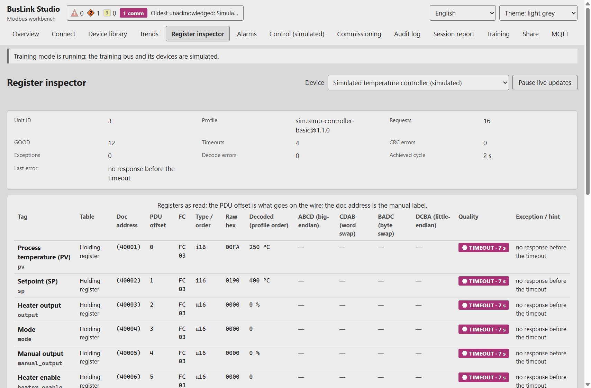

| Column | Meaning |
|---|---|
| Doc address | The label in the device manual, such as `40001` |
| PDU offset | The number actually sent on the wire. For example, `40001` is holding register offset `0` |
| FC | Function code: 01/02 bits, 03 holding registers, 04 input registers |
| Type / order | The data type and word order from the profile |
| Raw hex | The bytes received |
| Decoded | The value in the profile's word order. For 32-bit values all **four** orders are shown side by side (ABCD, CDAB, BADC, DCBA) |
| Quality, Exception / hint | The result, and a hint for exceptions |

**Last frames** lists each request (TX) and response (RX) in hex with its timing. Timeouts appear as a TX with no RX.

> Choose the word order from the device manual, not from whichever value looks plausible.

## 8. Alarms

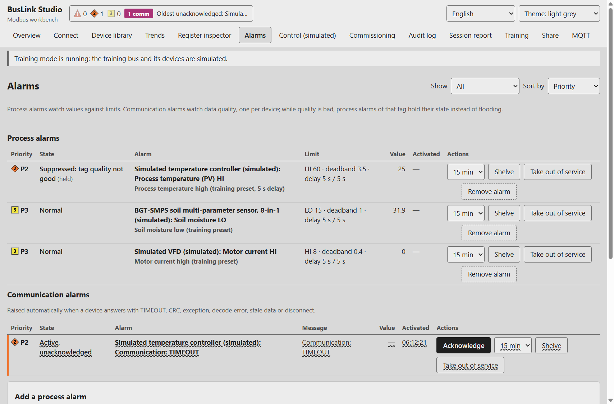

There are two kinds of alarm:

- **Process alarms** (HI, HIHI, LO, LOLO) that you define for a tag: limit, deadband, on-delay and off-delay, priority, optional latching, and a message. The default deadband and delays follow ISA-18.2 practice.
- **Communication alarms**, raised automatically when a device shows TIMEOUT, CRC, an exception, a decode error, stale data or a disconnect. While a device has a communication problem, its process alarms are **held** (Suppressed), because a stale value cannot be judged.

Actions: **Acknowledge**, **Shelve** (for a set time; it is logged and expires), **Take out of service** and **Return to service**. Acknowledged does not mean cleared. A burst of alarms (*alarm flood*) and chattering alarms are flagged.

## 9. Guarded writes (Control, simulated devices)

Writes are never casual. This release enables control only for the simulated VFD and the simulated temperature controller.

### 9.1 Monitoring and arming

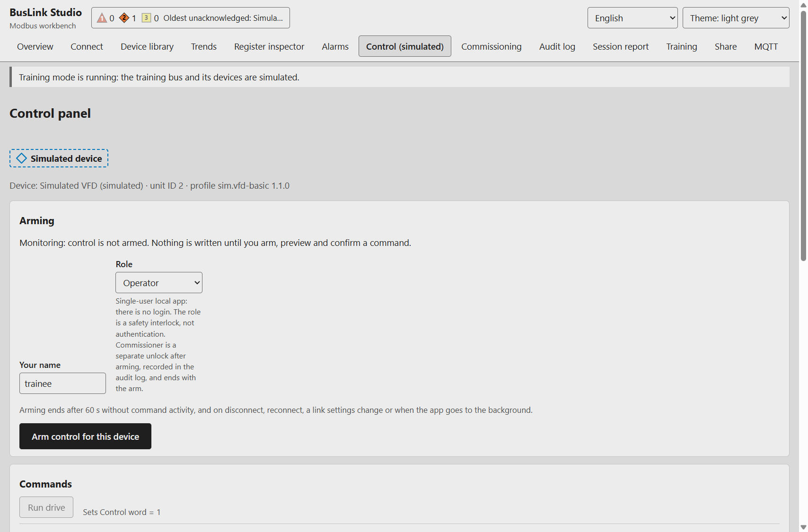

1. Open **Control (simulated)** from the device card.
2. Type your **user name**. It is written into the audit log, up to 64 characters.
3. Press **Arm control for this device**.

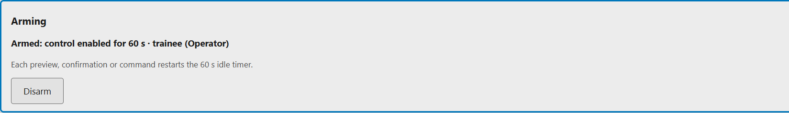

Arming ends after **60 s without command activity**, and also on disconnect, reconnect, a change of link settings, a profile change, or when the app goes to the background. Nothing re-arms by itself.

### 9.2 Bounds are checked, never clamped

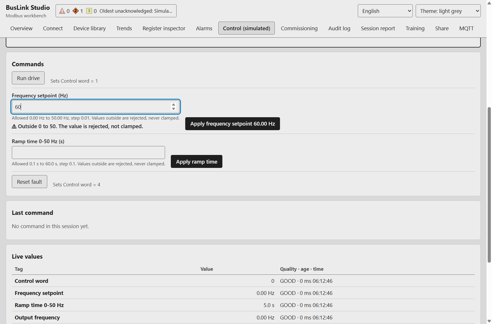

### 9.3 Confirm the exact frame

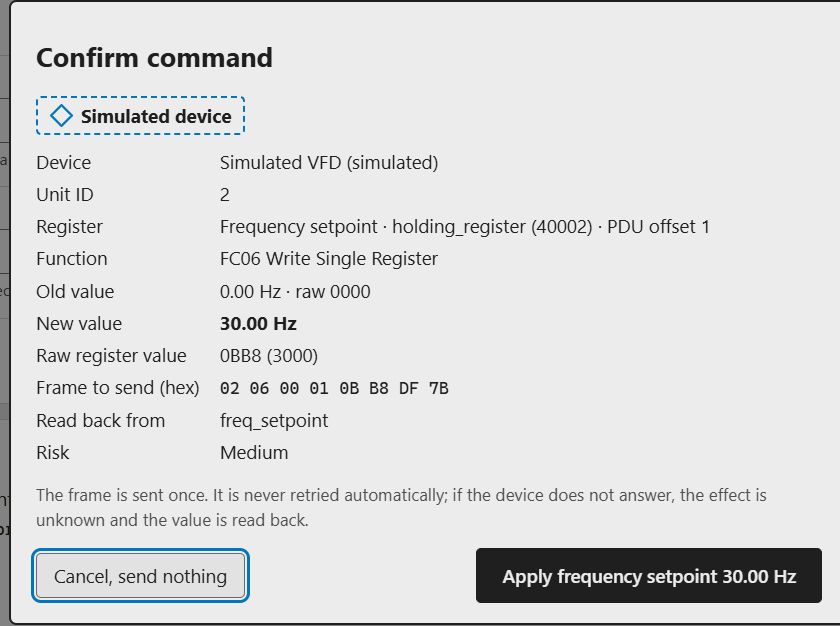

The dialog shows the request **exactly as it will be sent**, including the CRC. The safe choice (**Cancel**) has the focus. A command is sent **once**, with no automatic retry.

### 9.4 Acknowledge, read back, feedback

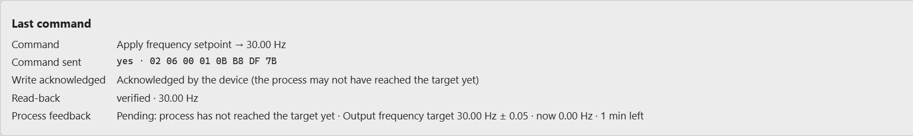

After sending, the app checks three things:

1. **Acknowledged**: the device echoed the request exactly.
2. **Read-back**: the register is read again and compared with the requested value.
3. **Feedback**: where the profile defines it, a process value is checked. For example, the output frequency must reach its target within the timeout.

> **Software stop. Not an emergency stop.** The stop command is an ordinary Modbus write. Emergency stopping must be done by a hard-wired safety circuit.

### 9.5 Roles

**Operator** is the default role. **Commissioner** is needed for communication settings (unit ID, baud rate). Selecting Commissioner is a separate, audited host action that ends with the arm. The app has no login. Roles are a safety interlock against mistakes, not authentication.

## 10. Commissioning wizard (unit ID and baud)

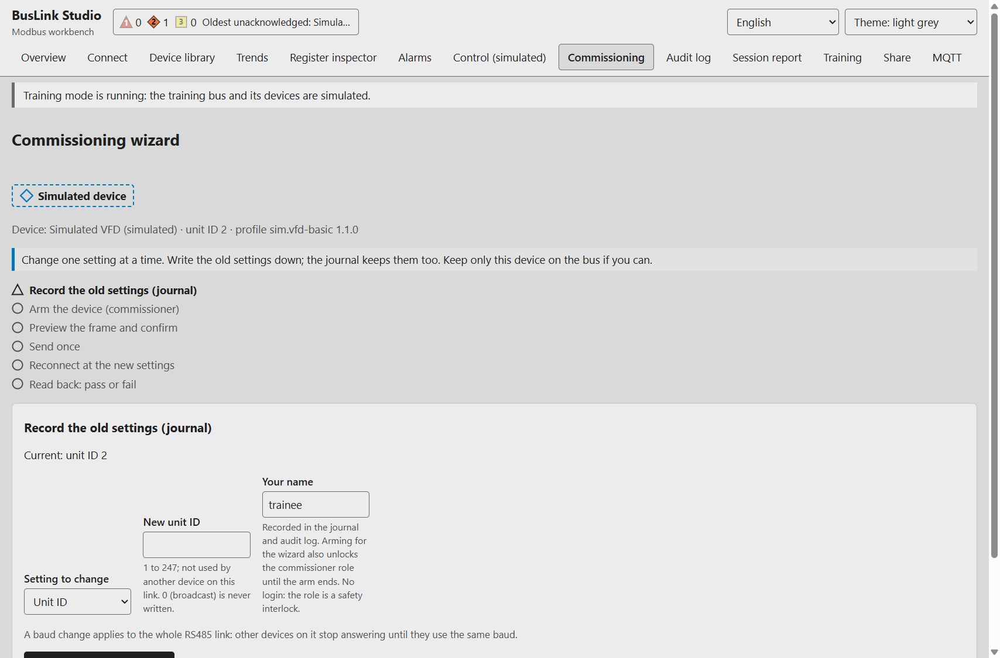

The wizard changes a device's own communication settings in six steps:

1. **Record the old settings** (journal).
2. **Arm** the device (commissioner).
3. **Preview the frame and confirm.**
4. **Send once.**
5. **Reconnect at the new settings.** If the profile says the change applies after a restart, power-cycle the device first.
6. **Read back:** pass or fail.

A baud-rate change applies to the **whole RS485 link**. The wizard lists the other devices on that link that will stop answering until they use the same baud. If verification fails, the wizard shows a recovery path: the old and new settings to try, one at a time. Only profiles that declare a `comm_config` block support the wizard. Others show "not available" with the reason.

## 11. Audit log and session report

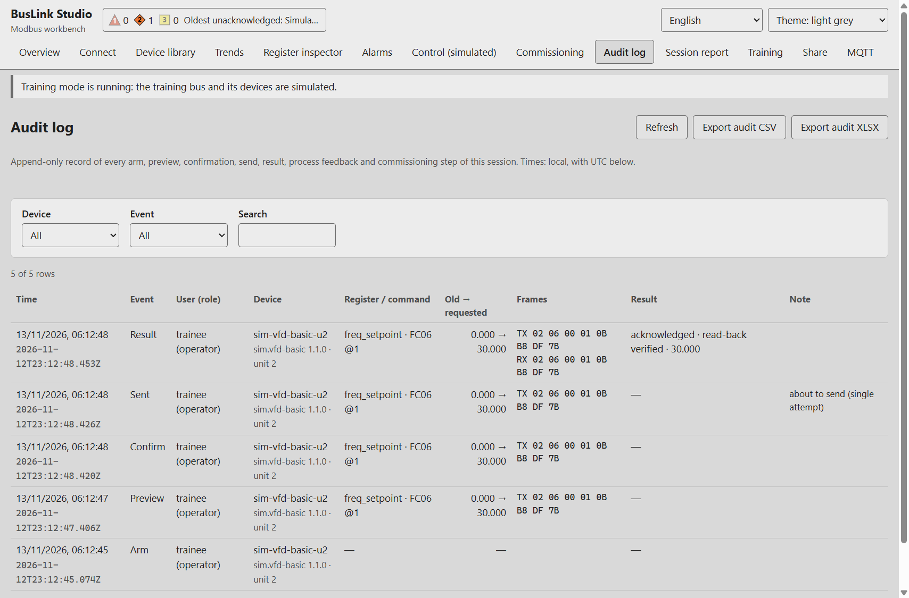

The **Audit log** is append-only. It records the time (local, with UTC below), event, user and role, device, register or command, old and requested values, frames, result and notes. Use **Export audit CSV / XLSX** to save it.

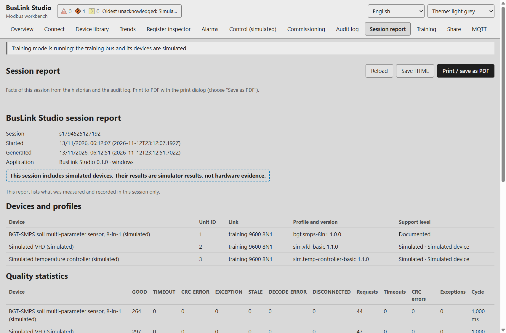

The **Session report** summarises the session for a commissioning record. Use **Save HTML** to write it as HTML, or **Print / save as PDF**.

## 12. Export data

On **Overview**, use **Export CSV**, **Export XLSX** or **Export JSON**. Every row carries:

- the time in ISO-8601 UTC;
- the device and tag;
- the value, with a dot as the decimal separator;
- the **quality**, the **exception code** and the **age in ms**;
- the profile version.

Text cells that start with `=`, `+`, `-` or `@` are escaped, so the file is safe to open in spreadsheet software (formula injection is blocked). On Android, export opens the system file picker.

## 13. Share a read-only dashboard on the LAN

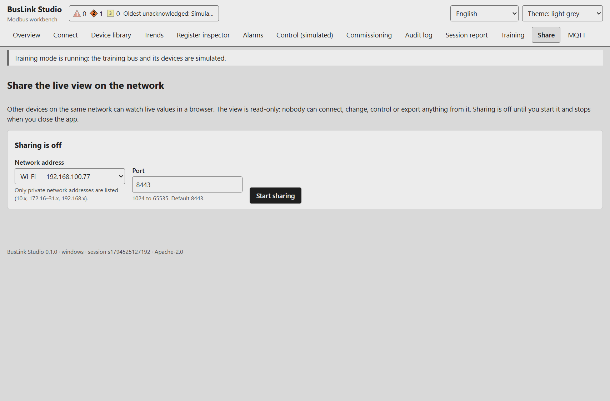

1. Open **Share**.
2. Choose the **Network address**. Only private addresses are listed: 10.x, 172.16–31.x and 192.168.x.
3. Choose the **Port** (default 8443) and press **Start sharing**.

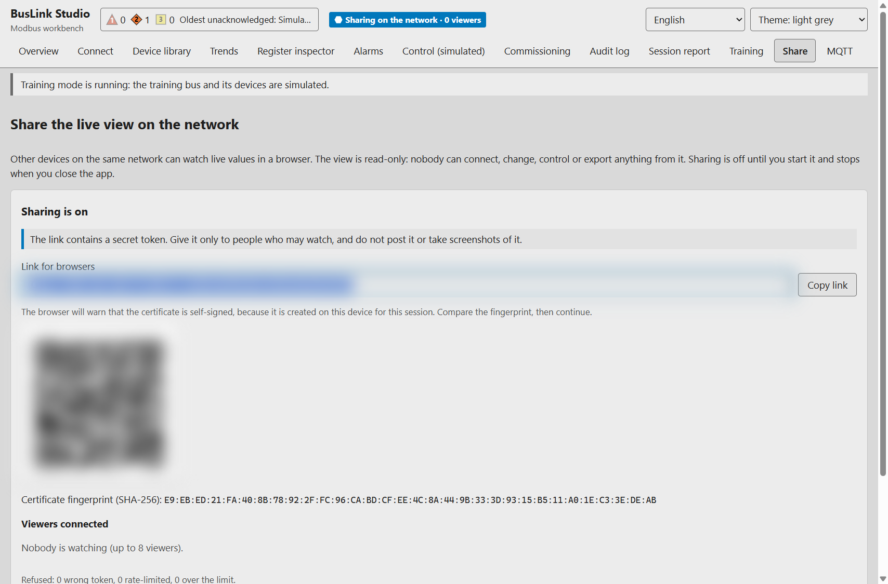

4. Give the link or QR code only to people who may watch. The link contains a one-session secret token.
5. Their browser warns that the certificate is self-signed, because it is created for this session. They should compare the SHA-256 fingerprint with the one on your screen, then continue.

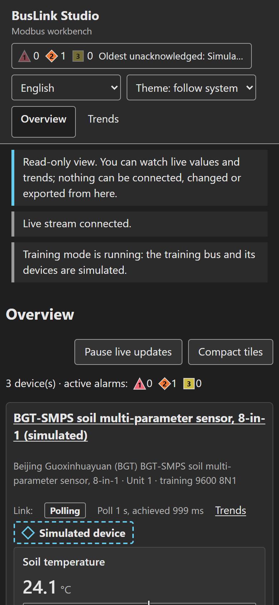

The shared view has **no connect, arm, write or export controls**, and the server accepts GET requests only. **Stop sharing** closes every connection. The next start creates a new token and certificate, so old links stop working.

## 14. MQTT telemetry

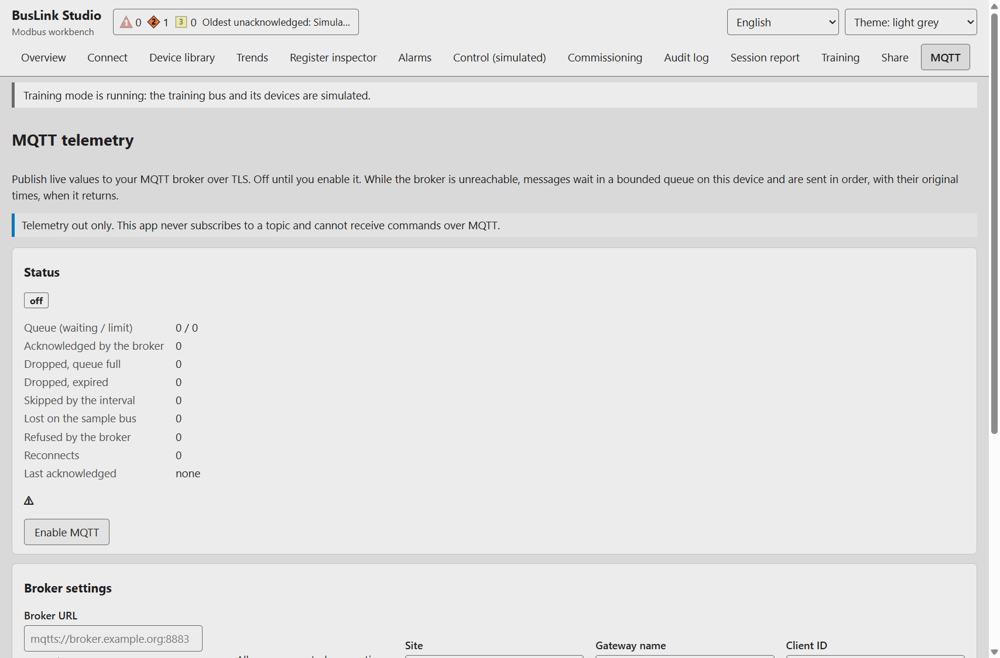

BusLink can publish values to an MQTT 5 broker for SCADA, historian or cloud use.

1. Enter the **Broker URL** (`mqtts://host:8883`), the **Site**, the **Gateway name** and the **Client ID**. Do not put a user name or password in the URL.
2. Enter a **User name** and **Password** if the broker needs them. On Windows the password is kept in Credential Manager and is never written to a file, a log or an export. On Android it is currently kept in memory only, and the panel says so.
3. Press **Test connection**, then **Save settings** and **Enable MQTT**.

Topic: `buslink/{site}/{gateway}/{device}/{tag}`. Payload: `{ts, seq, value, unit, quality, profile_version}`.

There is also a retained `status` topic with a last-will message `offline`. Messages are sent with QoS 1 and an expiry. If the broker is unreachable, messages wait in a bounded queue on the device and are replayed in order with their original time and sequence number. Consumers should deduplicate on `(session, seq)`.

**Telemetry out only.** The app never subscribes to a topic and cannot receive commands over MQTT.

## 15. Training mode and guided exercises

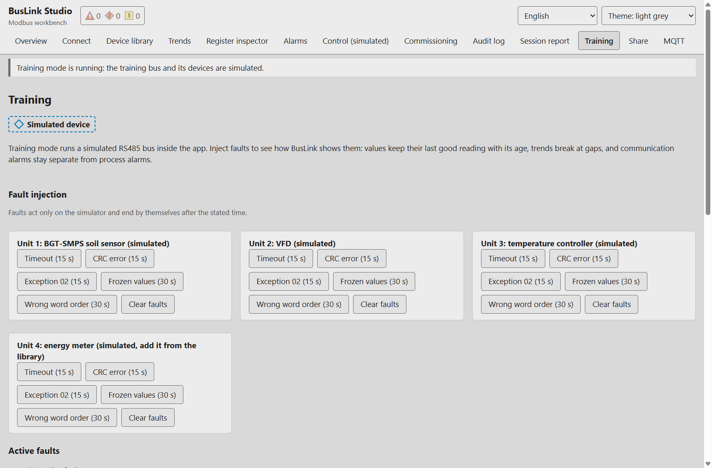

**Fault injection** applies only to the simulator, and each fault ends by itself after the stated time.

| Fault | What you will see |
|---|---|
| Timeout | TIMEOUT badges, struck-through values, a trend gap, a communication alarm |
| CRC error | CRC_ERROR quality; the frames show the corrupted reply |
| Exception 02 | EXCEPTION 02 (Illegal Data Address) |
| Frozen values | Replies stay GOOD but values stop changing, like a gateway serving a cache |
| Wrong word order | 32-bit values become wrong; compare the four orders in the inspector |

**Guided exercises:**

1. **Read three devices.** Note the unit, quality and age on each tile.
2. **Recognise a timeout gap.** A lost reply never becomes 0.
3. **Word-order check.** Choose the word order from the manual, not by plausibility.
4. **Frozen data.** GOOD quality describes the reply, not the process.
5. **Acknowledge and shelve.** Acknowledged is not cleared, and shelving expires.
6. **Export a record.** Find the TIMEOUT rows in the exported CSV.

## 16. Phone layout and themes

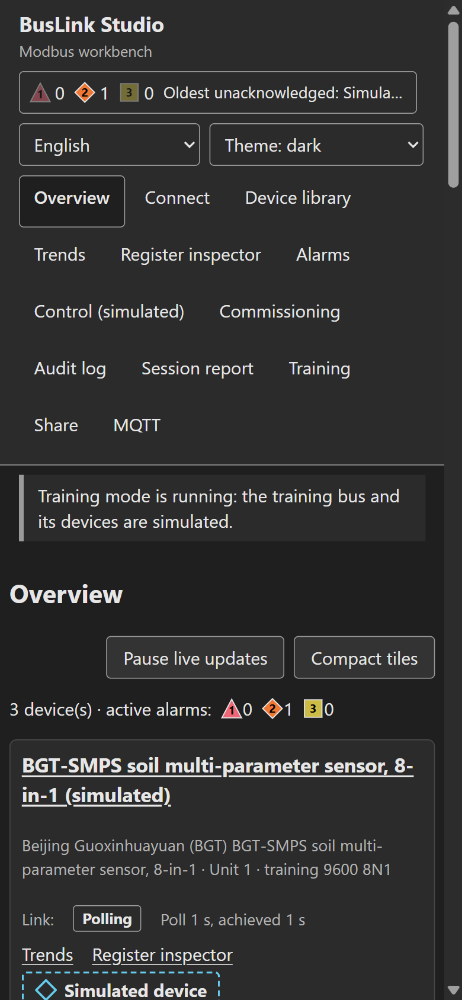

The layout works down to 360 px wide. Themes: system, light grey and dark. The UI is available in English and Bahasa Indonesia.

## 17. Troubleshooting

| Symptom | Likely causes | What to check |
|---|---|---|
| All tags TIMEOUT | Wrong unit ID, baud or parity; A/B swapped; no power; another master on the bus | Settings against the manual; swap A/B; measure the supply; close other tools |
| EXCEPTION 02 | The register address is not on the device | Doc address vs PDU offset in the inspector; off-by-one in the manual (40001 = offset 0) |
| EXCEPTION 01 | The device does not support that function code | FC03 vs FC04 in the profile |
| CRC_ERROR now and then | Noise, missing termination, a long stub, no GND reference | 120 Ω at both ends; twisted pair; GND wire; an isolated adapter |
| A 32-bit value is huge or tiny | Wrong word order | Compare the four orders in the inspector against the manual |
| A value is 10× or 100× off | Wrong scale in the profile | Scale and decimals against the manual |
| Values GOOD but never change | A gateway serving a cache, or a frozen sensor | Age and trend; the device's own diagnostics |
| STALE | Polling stopped, or the poll interval is too long for the threshold | The link state; the poll interval |
| No serial port listed | Driver, cable, or an adapter in use by another program | Device Manager; refresh ports |
| Android: no permission dialog | The filter did not match, or permission was denied earlier | Replug the adapter; choose BusLink and "Use by default" |
| A LAN viewer cannot open the link | Different subnet, firewall, AP client isolation, or the token changed | The same Wi-Fi; the Windows firewall prompt; start sharing again and resend the link |

# Part B · Technical reference

## 18. Architecture

```
src (TypeScript UI, no framework) ───── Tauri IPC ─────┐
                                                       ▼
src-tauri (Tauri 2 shell) ── commands, state, share, Android bridge
          │
          ▼
crates/buslink-core  ── protocol (RTU/TCP codec, CRC) · poll scheduler
                       quality & alarms · historian (SQLite) · trends
                       command service (only write path) · exports
                       LAN server (axum, TLS) · MQTT (rumqttc, outbox)
crates/buslink-sim   ── multi-device simulator with fault injection
plugins/tauri-plugin-buslink-usb ── Kotlin: usb-serial-for-android,
                       permission flow, connectedDevice foreground service
```

- **One core, three faces.** The Windows app, the Android app and the LAN view all use the same Rust core and the same built UI. The LAN view is that UI in read-only mode.
- **Session state lives in Rust.** Rotating the phone or recreating the activity keeps the connection and the data.
- **Transport trait.** Serial (Windows), USB (Android, buffered so that fragmented USB packets do not break RTU framing), TCP and the simulator all implement one trait.

## 19. Protocol details

- RTU framing uses the inter-frame gap t3.5 (fixed at 1.75 ms above 19 200 baud), at least 5 ms.
- The default response timeout is the request plus the longest response on the wire plus 300 ms device turnaround, at least 500 ms.
- CRC-16/MODBUS. The test vector `01 03 00 00 00 08 44 0C` reads 8 holding registers from unit 1.
- Read limits: 125 registers or 2000 bits per request. Adjacent tags are merged into one read when the gap allows. A tag is never split.
- Android links wait at least 50 ms between frames.

## 20. Quality and timing model

Each sample carries `quality`, `value`, `value_ts` (the time the value was last good), `age_ms` and the exception code. Rules:

1. A failed read never produces a new value. The last good value is kept with its original time and is marked by the new quality.
2. STALE is decided by age: age > max(3 × poll interval, 3 s).
3. Trends and exports carry the quality on every point. Trend lines break at every non-GOOD point.
4. A disconnect waits up to 1 s for samples already published, then marks every tag DISCONNECTED. This was a real race, found and fixed during development.

## 21. Write path and safety rules

All encoding of FC05, FC06, FC15 and FC16 lives in `crates/buslink-core/src/command/`. A Kiro hook blocks write function codes, raw write frames and unit ID 0 everywhere else. The command service enforces:

| Rule | Mechanism |
|---|---|
| No send without arming | `ensure_armed` is checked at preview, confirm and execute; arming expires |
| No send without confirmation | `execute` requires the Confirmed state; the frame object is consumed by `send` |
| Never twice | A second execute fails with `WrongState`; there is no retry anywhere in the module |
| Never broadcast | Unit 0 is rejected as `BroadcastRejected` |
| Bounds | Rejected, never clamped: min/max/step/allowed values/valid range; non-finite values rejected |
| Audit first | If the audit row cannot be written, nothing is sent (fail-closed) |
| Simulated only | Control needs the session's own simulator link marker; a manual loopback link is monitor-only |
| Software stop | Labelled "Not an emergency stop" |

## 22. Device profile format (schema v1)

A profile is a JSON file in `profiles/`. It has a strict schema and contains **no scripts and no expressions**. Its main parts:

- **Top level:** `profile_id`, `profile_version`, `vendor`, `model`, `support_level`, `simulated_only`.
- **`transport`:** default serial settings.
- **`registers`:** one entry per register.
- **`commands`:** simulated devices only in v1.
- **`comm_config`:** the registers used by the commissioning wizard.

Example register:

```json
{
  "id": "freq_setpoint",
  "name": { "en": "Frequency setpoint", "id": "Setpoint frekuensi" },
  "table": "holding_register",
  "address": 1,
  "type": "u16",
  "scale": 0.01,
  "unit": "Hz",
  "decimals": 2,
  "valid_range": [0, 50],
  "access": "read_write",
  "write": { "min": 0, "max": 50, "step": 0.01, "risk": "medium", "role": "operator" }
}
```

- `table`: `coil`, `discrete_input`, `holding_register` or `input_register`.
- `address`: the zero-based PDU offset.
- `type`: such as `u16`, `i16`, `u32`, `i32` or `f32`, with a word order for 32-bit types.
- `display_range`: optional, used for the analog bar only. It never affects decoding.

Profiles over 1 MB, duplicate keys and unknown fields are rejected at load time. The full schema is in `docs/profiles/schema-v1.md` and `profiles/schema/buslink-profile.schema.json`.

## 23. Security design

| Area | Design |
|---|---|
| Desktop app | Tauri capability `core:default` only; strict CSP; no remote content; text-only rendering (no `innerHTML`) |
| LAN server | Off by default; private IPv4 only (refuses 0.0.0.0, IPv6 and public addresses); port ≥ 1024; a per-session rcgen certificate; a 128-bit token compared in constant time; the token accepted only on `GET /`, then a `Secure; HttpOnly; SameSite=Strict` cookie; GET-only, request bodies rejected; rate limit with lockout after 5 failures; 32 connections, 4 per address, 8 unauthenticated |
| MQTT | TLS by default (native roots plus an optional CA); credentials never in the URL, files or logs; no subscriptions; a bounded outbox |
| Android | Service not exported; no storage permission; file export through the system picker; USB permission with one request at a time and a 60 s timeout |
| Release builds | A guard fails the build if test-only (`e2e`) code reaches an installer |

A read-only Kiro agent reviewed the code against IEC 62443-4-2 and OWASP. It found 0 critical, 0 high, 2 medium and 6 low issues. Both medium findings and three of the low ones are fixed with tests. The rest are accepted with reasons in `docs/security/review-07-fixes.md`.

## 24. Verification

| Check | Result |
|---|---|
| `cargo test --workspace` | 274 passed (includes seeded property-based tests; any failure prints a replay seed) |
| `npm test` | 37 passed |
| Journey 1: dashboard, timeout, trend gap, export | 15/15 |
| Journey 3: LAN share, token, read-only, stop | 38/38 |
| Journey 4: arm, confirm, read-back, audit | 30/30 |
| Windows installer: silent install, launch, uninstall | pass |
| Android phone with a real sensor | **not run yet** |

All journeys run on the real Windows app against the simulator. Details are in `docs/verification/README.md`.

## 25. Known limits

- Control is limited to simulated devices in v1.
- The Android build has not been tested on a phone with a real sensor. Android Keystore storage for the MQTT password is not implemented.
- There is no login: the app is a single-user local tool, and roles are interlocks.
- The software stop is not an emergency stop. BusLink is not safety-certified software.
- The Windows installer is not code-signed.

## 26. License and credits

Apache-2.0. Third-party libraries are listed in `THIRD_PARTY_NOTICES.md`, and pre-existing work is disclosed in `docs/existing-code-disclosure.md`. Built for Kiroween 2026 with Kiro: 7 specs, 60 tasks and 12 logged Kiro CLI sessions.
