# Tentang manual ini

BusLink Studio adalah *workbench* Modbus terbuka untuk commissioning, perawatan, dan pelatihan. Aplikasi ini membaca perangkat RS485 (Modbus RTU) dan Ethernet (Modbus TCP). Aplikasi berjalan di Windows dan di ponsel Android (lewat adaptor USB-C OTG), dan dapat membagikan dashboard hanya-baca ke browser mana pun di jaringan yang sama. Setiap model perangkat dijelaskan oleh satu **profil perangkat**, dan file profil yang sama berlaku di semua platform.

Manual ini terdiri dari dua bagian:

- **Bagian A, panduan pengguna:** memasang aplikasi, menghubungkan, membaca nilai, tren, alarm, penulisan terjaga, commissioning, ekspor, berbagi lewat LAN, MQTT, dan mode pelatihan.
- **Bagian B, referensi teknis:** arsitektur, model kualitas data, aturan keselamatan, format profil, desain keamanan, verifikasi, dan batasan.

> **Status rilis ini.** Semua tampilan di manual ini diambil dari aplikasi Windows yang sebenarnya (versi 0.1.0) yang menjalankan **Mode pelatihan**, sehingga semua perangkat yang tampil adalah simulasi. Build Android berhasil dikompilasi, tetapi belum diuji di ponsel dengan sensor nyata. Pada rilis ini, perintah kontrol hanya aktif untuk perangkat simulasi.

## Untuk siapa

| Pengguna | Tugas umum |
|---|---|
| Teknisi lapangan | Menyambung sensor baru, memastikan sensor menjawab, membaca nilai live beserta kualitas dan umurnya |
| Engineer commissioning | Mengatur unit ID atau baud rate perangkat dan membuktikan perubahannya dengan baca balik |
| Engineer perawatan | Mencari penyebab nilai yang salah: timeout, exception, urutan word, atau skala |
| Supervisor | Memantau dashboard live hanya-baca dari browser |
| Pelatih atau siswa | Berlatih menangani gangguan dengan aman memakai simulator bawaan |

## Konvensi

- Teks **tebal** adalah nama tombol, menu, atau kolom persis seperti yang tampil di aplikasi.
- `Kode` menandai nama file, nilai, dan frame seperti yang dikirim di kabel.
- *Unit ID* adalah alamat slave Modbus (1–247 di serial, 1–255 di TCP). **0 (broadcast) tidak pernah dipakai.**

# Bagian A · Panduan pengguna

## 1. Memasang dan menjalankan

### 1.1 Windows

1. Unduh `BusLink-Studio_0.1.0_x64-setup.exe` dari halaman rilis GitHub (<https://github.com/Wayan123/buslink-studio/releases/latest>). Anda dapat mencocokkan file dengan `SHA256SUMS.txt` di halaman yang sama.
2. Jalankan installer. Installer belum ditandatangani, sehingga Windows SmartScreen dapat menampilkan "Windows protected your PC". Pilih **More info → Run anyway**.
3. Buka **BusLink Studio** dari menu Start.

Kebutuhan: Windows 10 atau 11 (x64) dengan WebView2, yang sudah ada di Windows 11. Hak administrator tidak diperlukan untuk membaca perangkat.

### 1.2 Android (pratinjau)

APK debug arm64 dibangun dari source code (lihat `docs/android-build.md`). Diperlukan Android 7.0 (API 24) atau lebih baru, dukungan USB host, dan adaptor USB-C OTG. Prosedur uji di ponsel dengan sensor nyata ada di `docs/verification/android-hardware.md`.

### 1.3 Dari source code

```
npm ci
npm run tauri dev           # aplikasi desktop
cargo test --workspace      # tes Rust
npm test                    # tes UI
```

## 2. Sekilas tampilan layar

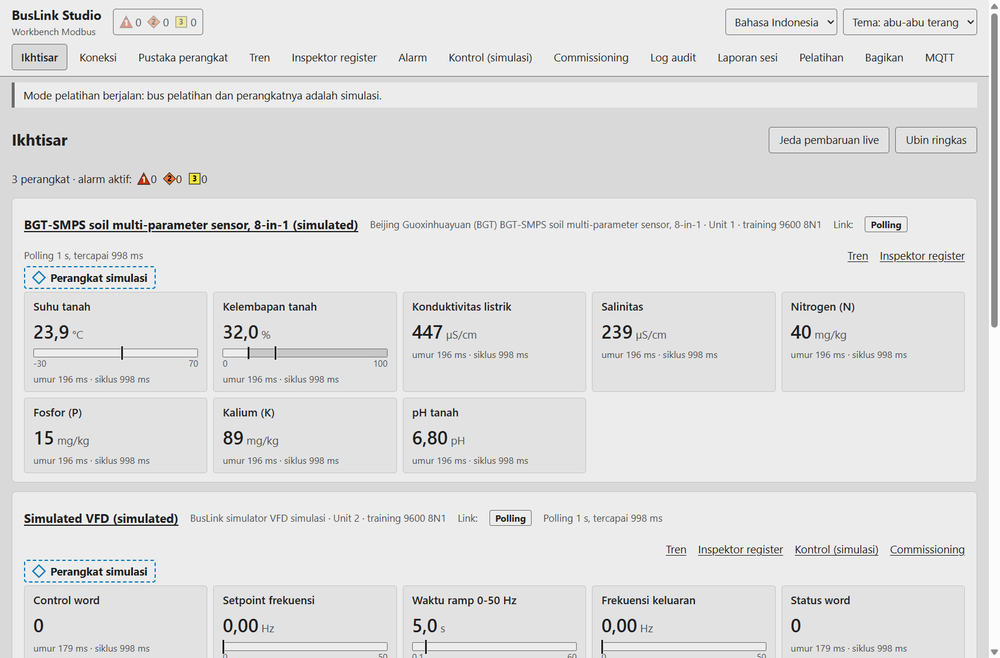

| Area | Isi |
|---|---|
| Header, kiri | Nama aplikasi dan **penghitung alarm**: prioritas 1 (segitiga merah), 2 (belah ketupat oranye), dan 3 (kotak kuning). Bentuknya yang penting, bukan hanya warnanya. |
| Header, kanan | Bahasa (**English** / **Bahasa Indonesia**) dan **Tema** (ikuti sistem, abu-abu terang, gelap). |
| Bilah navigasi | **Ikhtisar, Koneksi, Pustaka perangkat, Tren, Inspektor register, Alarm, Kontrol (simulasi), Commissioning, Log audit, Laporan sesi, Pelatihan, Bagikan, MQTT** |
| Banner | Pemberitahuan status, misalnya "Mode pelatihan berjalan" atau "Berbagi di jaringan". |
| Kartu perangkat | Satu kartu per perangkat: nama, model, unit, pengaturan link, status link, laju polling, dan ubin nilai. |

Dashboard mengikuti praktik HMI berkinerja tinggi (ISA-101): **abu-abu berarti normal**, dan warna hanya muncul bila ada yang perlu diperhatikan. Nilai normal tidak pernah ditampilkan hijau.

## 3. Menghubungkan link

Buka **Koneksi**.

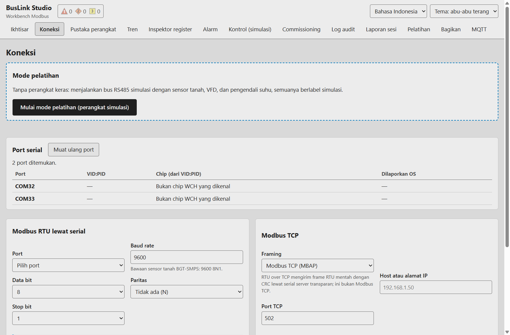

**Link** adalah satu jalur komunikasi: satu port serial atau satu koneksi TCP. Satu link dapat membawa beberapa perangkat dengan unit ID yang berbeda.

### 3.1 Mode pelatihan (tanpa perangkat keras)

Tekan **Mulai mode pelatihan (perangkat simulasi)**. Aplikasi menjalankan bus RS485 simulasi dengan tiga perangkat, masing-masing berlabel "Perangkat simulasi":

| Unit | Perangkat | Nilai utama |
|---|---|---|
| 1 | Sensor tanah BGT-SMPS 8-in-1 | suhu, kelembapan, EC, salinitas, N, P, K, pH |
| 2 | Inverter / VFD | control word, setpoint frekuensi, ramp, frekuensi keluaran, arus, status |
| 3 | Pengendali suhu | PV, SP, output, mode |

Meter energi (unit 4) dapat ditambahkan dari **Pustaka perangkat**.

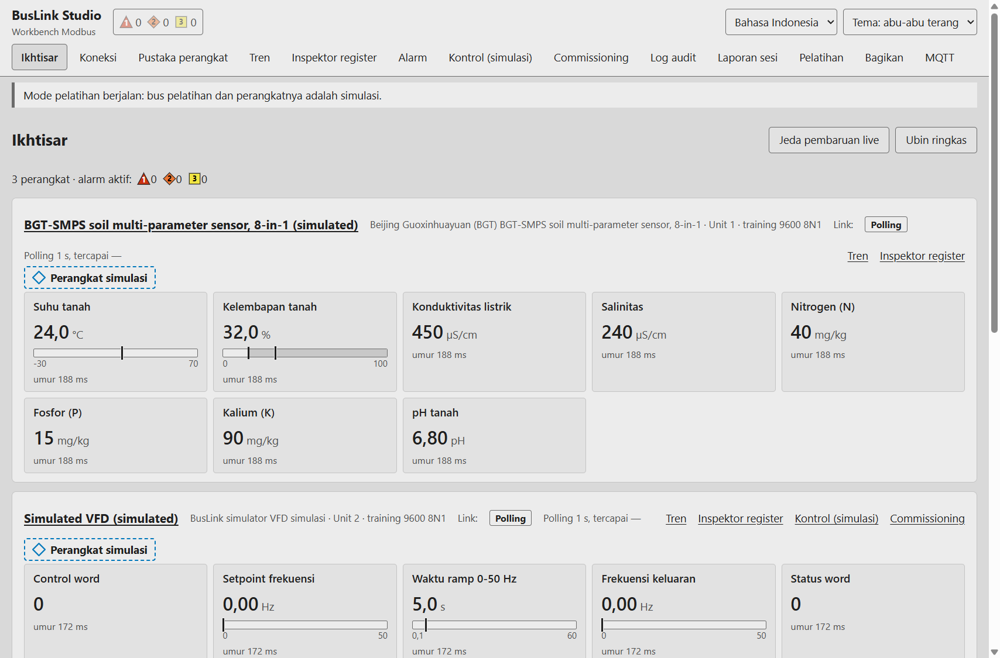

### 3.2 Modbus RTU lewat serial (RS485)

1. Colokkan adaptor USB-RS485, lalu tekan **Muat ulang port**. Tabel menampilkan setiap port beserta VID:PID-nya dan, untuk chip WCH, nama chipnya. Contohnya, `1A86:55D3` adalah WCH CH343.
2. Pilih **Port**, lalu atur **Baud rate**, **Data bits**, **Parity**, dan **Stop bits** sesuai manual perangkat. Default sensor tanah adalah 9600 8N1.
3. Tekan **Hubungkan link serial**.

**Daftar periksa pengkabelan:**

- Sambungkan A+ ke A+, B− ke B−, dan GND ke GND.
- Pakai kabel twisted-pair dan sambung perangkat secara berantai (daisy chain), bukan bintang.
- Pasang terminasi 120 Ω di kedua ujung bus.
- Beri daya perangkat dari catu dayanya sendiri, jangan dari port USB.
- Hanya **satu master** yang boleh mem-polling bus pada satu waktu, jadi tutup dulu aplikasi Modbus lain.
- Adaptor Waveshare USB TO RS485 (B) **tidak terisolasi**. Untuk pekerjaan lapangan, gunakan adaptor terisolasi.

### 3.3 Modbus TCP

Pilih **Framing**:

- **Modbus TCP (MBAP)** untuk perangkat Ethernet dan gateway biasa (port 502).
- **RTU over TCP** untuk serial server transparan yang meneruskan frame RTU mentah beserta CRC-nya. Ini berbeda dengan Modbus TCP.

Isi **Host atau alamat IP** dan **Port TCP**, lalu tekan **Hubungkan link TCP**. Di Wi-Fi, fitur *client isolation* pada access point dapat memblokir koneksi.

## 4. Menambah perangkat dari pustaka

Buka **Pustaka perangkat**.

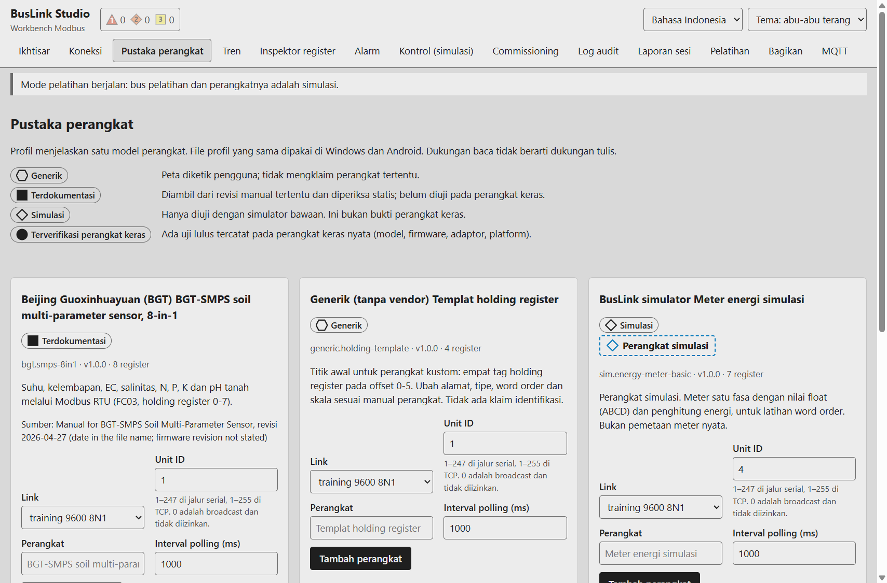

1. Cari model perangkat, lalu periksa dokumen sumber dan revisinya.
2. Pilih **Link**, lalu isi **Unit ID** dan **Interval polling (ms)**. Interval boleh 100 ms sampai 24 jam.
3. Tekan **Tambah perangkat**, lalu mulai polling untuk link tersebut di halaman **Koneksi**.

Tingkat dukungan itu penting: dukungan baca tidak berarti dukungan tulis. Sebuah profil hanya mengizinkan penulisan yang ia deklarasikan, lengkap dengan batasnya.

## 5. Membaca nilai live

### 5.1 Ubin nilai

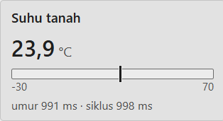

Setiap ubin menampilkan:

- **Nama** dan **nilai beserta satuannya**, dengan jumlah desimal sesuai profil.
- **Bar analog**. Bar ini hanya muncul bila profil mendeklarasikan rentang (`valid_range` atau `display_range`). Pita berarsir adalah rentang normal, dan garis kecil adalah batas alarm. Jika nilai keluar dari rentang, penanda ditahan di ujung bar dan ubin menampilkan "Di luar skala".
- **umur**: waktu sejak nilai ini terakhir berhasil dibaca.
- **siklus**: periode polling yang benar-benar tercapai.

### 5.2 Kualitas data: arti setiap label

Setiap nilai membawa label kualitas. Hanya nilai **GOOD** (Baik) yang ditampilkan sebagai nilai terkini.

| Kualitas | Arti | Yang dilakukan ubin |
|---|---|---|
| GOOD | Perangkat menjawab dan nilainya berhasil didekode | Ubin abu-abu normal |
| TIMEOUT | Perangkat tidak menjawab tepat waktu | Badge; nilai terakhir disimpan tetapi **dicoret**; umur terus bertambah |
| CRC_ERROR | Balasan rusak di kabel | Badge; nilai terakhir dicoret |
| EXCEPTION | Perangkat menjawab dengan exception Modbus (misalnya 02 Illegal Data Address) | Badge dengan kode exception |
| STALE | Tidak ada data baru dalam batas waktu basi (sekitar 3× interval polling, minimal 3 detik) | Badge; nilai dicoret |
| DECODE_ERROR | Nilai mentah melanggar aturan profil | Badge |
| DISCONNECTED | Link tidak sedang polling | Badge |

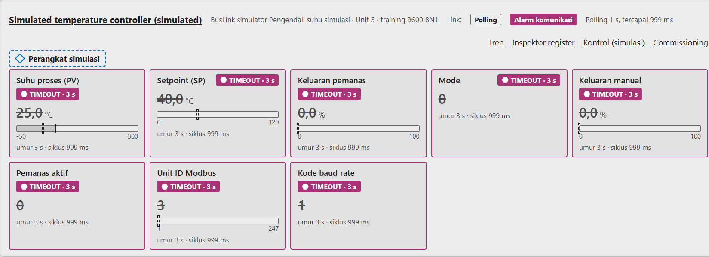

Balasan yang hilang **tidak pernah** menjadi 0 atau nilai baru. Perangkat lain di link yang sama tetap di-polling.

### 5.3 Banner alarm


Banner menghitung alarm aktif per prioritas dan menyebut alarm terlama yang belum diakui. Klik banner untuk membuka **Alarm**.

## 6. Tren

Buka **Tren** dan pilih perangkat, atau pakai tautan **Tren** di kartu perangkat.

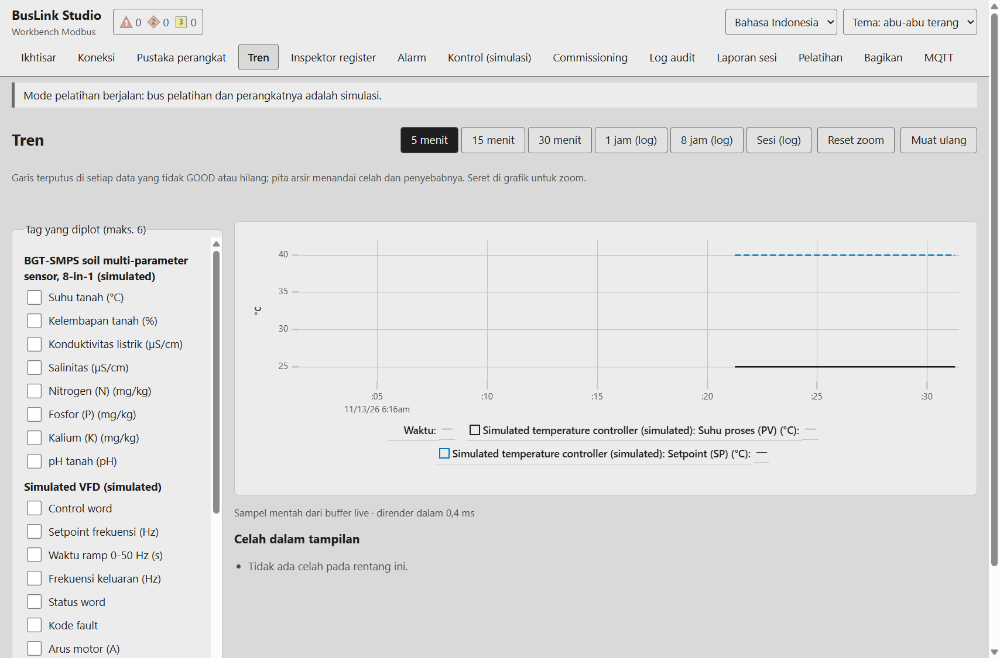

- **Rentang waktu:** 5, 15, atau 30 menit dari buffer live, atau 1 jam, 8 jam, atau seluruh sesi dari log.
- **Tag yang diplot:** pilih satu tag atau lebih (ada batas jumlahnya).
- **Seret** di grafik untuk memperbesar, lalu tekan **Reset zoom** untuk kembali.

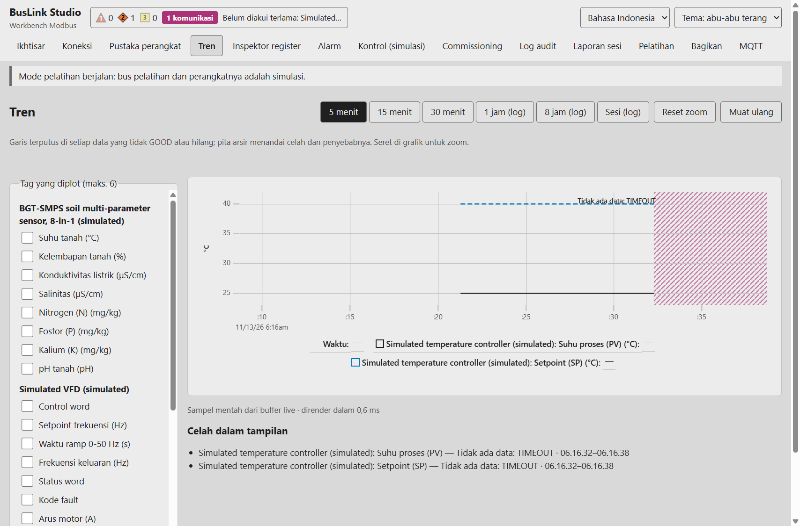

Garis **terputus di setiap titik yang tidak GOOD**. Tidak ada interpolasi melintasi celah. Daftar **Celah dalam tampilan** di bawah grafik menyebut awal, akhir, dan alasan setiap celah. Rentang panjang diringkas menjadi min/maks per piksel, sehingga lonjakan tetap terlihat.

## 7. Inspektor register

Buka **Inspektor register** untuk melihat persis apa yang dikirim di kabel.

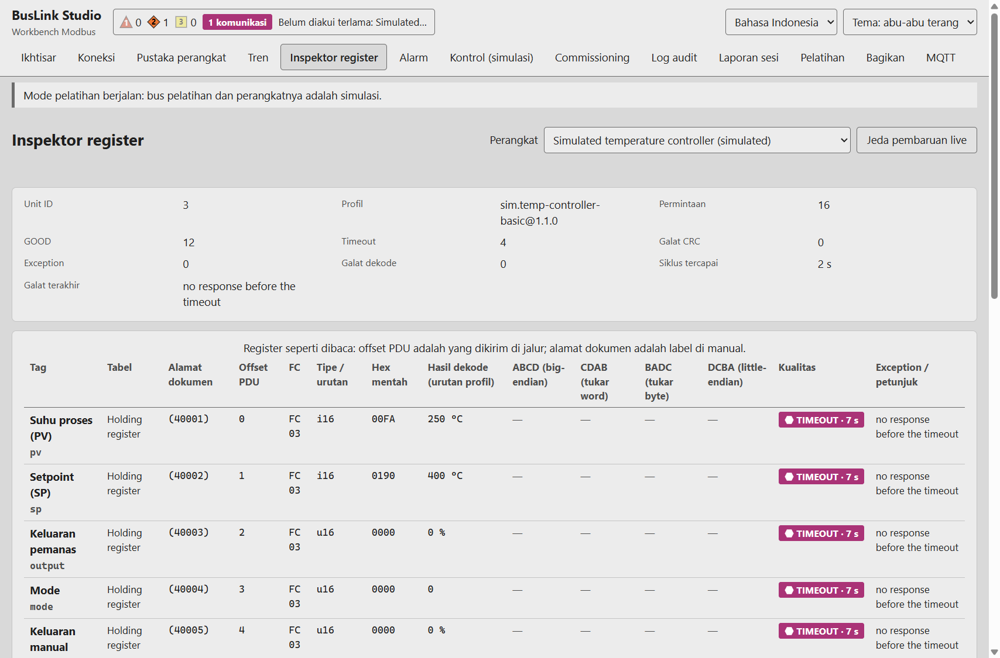

| Kolom | Arti |
|---|---|
| Alamat dokumen | Label di manual perangkat, misalnya `40001` |
| Offset PDU | Angka yang benar-benar dikirim di kabel. Misalnya, `40001` adalah offset holding register `0` |
| FC | Kode fungsi: 01/02 bit, 03 holding register, 04 input register |
| Tipe / urutan | Tipe data dan urutan word dari profil |
| Hex mentah | Byte yang diterima |
| Hasil dekode | Nilai dalam urutan word profil. Untuk nilai 32-bit, **keempat** urutan ditampilkan berdampingan (ABCD, CDAB, BADC, DCBA) |
| Kualitas, Exception / petunjuk | Hasil pembacaan, dan petunjuk untuk exception |

**Frame terakhir** mencantumkan setiap permintaan (TX) dan jawaban (RX) dalam hex beserta waktunya. Timeout tampil sebagai TX tanpa RX.

> Pilih urutan word berdasarkan manual perangkat, bukan berdasarkan nilai yang tampak masuk akal.

## 8. Alarm

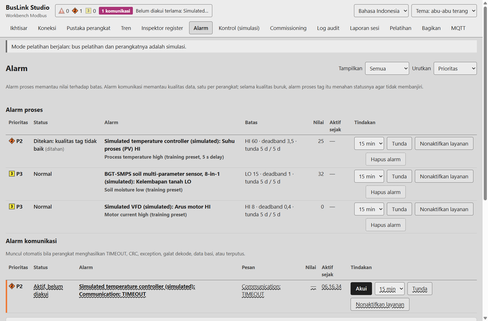

Ada dua jenis alarm:

- **Alarm proses** (HI, HIHI, LO, LOLO) yang Anda definisikan untuk sebuah tag: batas, deadband, on-delay dan off-delay, prioritas, opsi latching, dan pesan. Deadband dan delay bawaan mengikuti praktik ISA-18.2.
- **Alarm komunikasi**, yang muncul otomatis bila perangkat mengalami TIMEOUT, CRC, exception, galat dekode, data basi, atau terputus. Selama perangkat bermasalah komunikasi, alarm prosesnya **ditahan** (Ditekan), karena nilai yang basi tidak bisa dinilai.

Aksi yang tersedia: **Akui**, **Tunda** (untuk durasi tertentu; tercatat dan berakhir sendiri), **Nonaktifkan layanan**, dan **Aktifkan layanan**. Diakui tidak berarti sudah pulih. Banjir alarm (*alarm flood*) dan alarm yang berkedip-kedip (*chattering*) ditandai.

## 9. Penulisan terjaga (Kontrol, perangkat simulasi)

Penulisan tidak pernah dilakukan sembarangan. Pada rilis ini, kontrol hanya aktif untuk VFD dan pengendali suhu simulasi.

### 9.1 Pemantauan dan arming

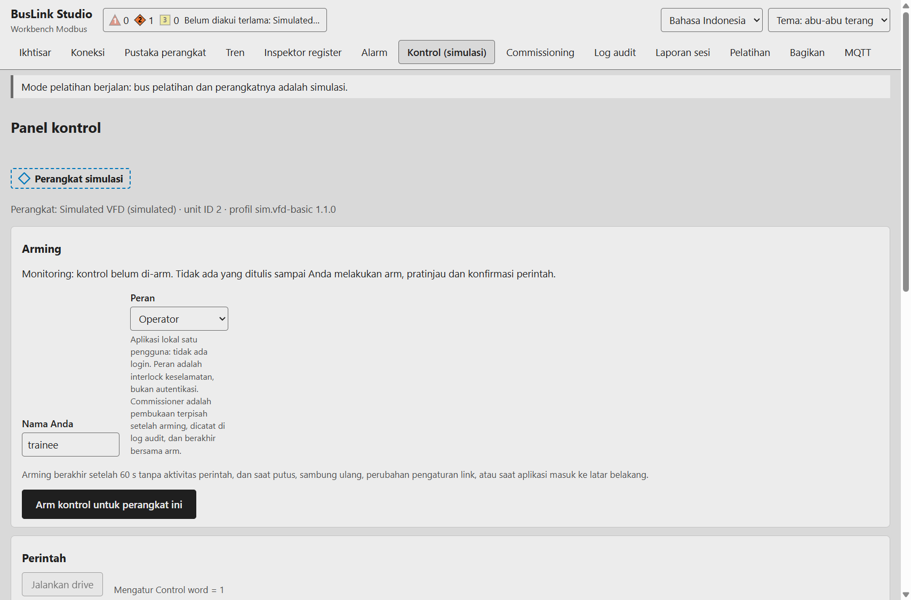

1. Buka **Kontrol (simulasi)** dari kartu perangkat.
2. Ketik **nama pengguna** Anda. Nama ini ditulis ke log audit, maksimal 64 karakter.
3. Tekan **Arm kontrol untuk perangkat ini**.

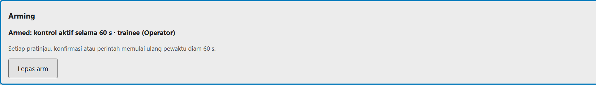

Arming berakhir setelah **60 detik tanpa aktivitas perintah**, dan juga saat link terputus, tersambung ulang, pengaturan link berubah, profil berubah, atau aplikasi masuk ke latar belakang. Tidak ada yang meng-arm ulang dengan sendirinya.

### 9.2 Batas diperiksa, tidak pernah dipotong

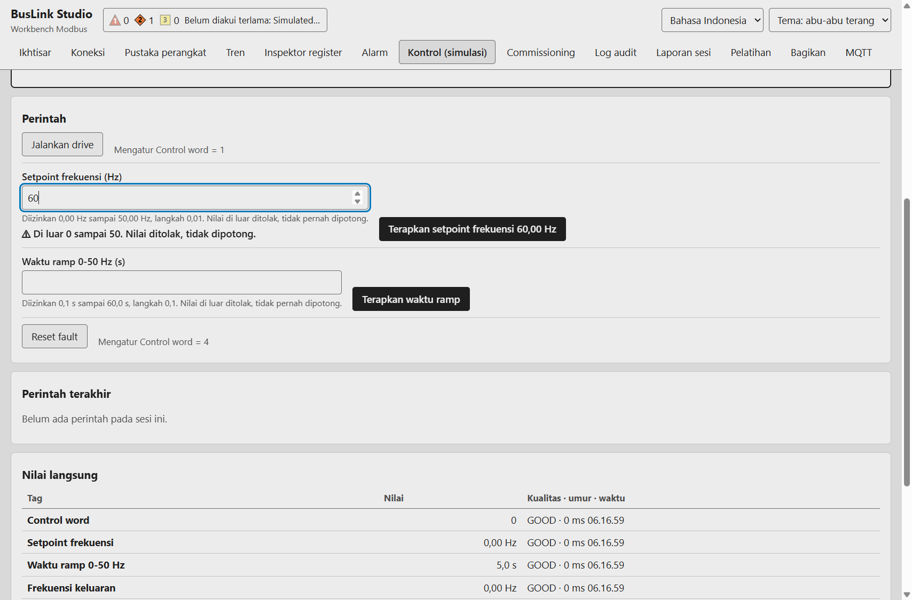

### 9.3 Konfirmasi frame yang persis

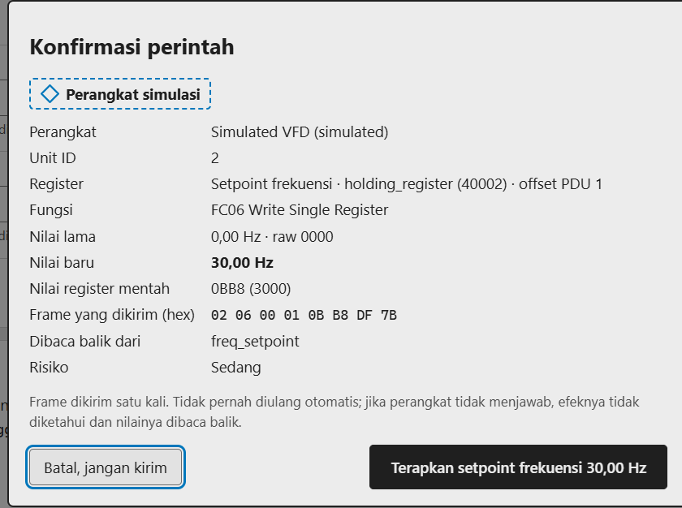

Dialog menampilkan permintaan **persis seperti yang akan dikirim**, termasuk CRC-nya. Pilihan aman (**Batal, jangan kirim**) mendapat fokus. Perintah dikirim **satu kali**, tanpa pengulangan otomatis.

### 9.4 Pengakuan, baca balik, dan umpan balik


Setelah mengirim, aplikasi memeriksa tiga hal:

1. **Pengakuan**: perangkat mengembalikan echo yang persis sama dengan permintaan.
2. **Baca balik**: register dibaca lagi dan dibandingkan dengan nilai yang diminta.
3. **Umpan balik proses**: bila profil mendefinisikannya, nilai proses ikut diperiksa. Misalnya, frekuensi keluaran harus mencapai targetnya dalam batas waktu.

> **Stop perangkat lunak. Bukan emergency stop.** Perintah stop adalah penulisan Modbus biasa. Penghentian darurat wajib dilakukan oleh rangkaian keselamatan yang terhubung langsung (hard-wired).

### 9.5 Peran

**Operator** adalah peran bawaan. Peran **Commissioner** diperlukan untuk pengaturan komunikasi (unit ID, baud rate). Memilih Commissioner adalah aksi terpisah di sisi host yang tercatat di audit dan berakhir bersama arming. Aplikasi ini tidak memiliki login. Peran berfungsi sebagai interlock pencegah kesalahan, bukan autentikasi.

## 10. Wizard commissioning (unit ID dan baud)

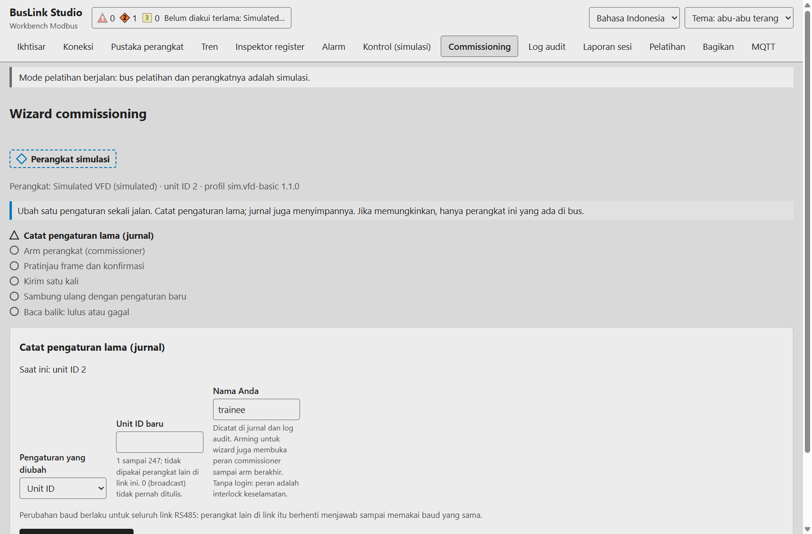

Wizard mengubah pengaturan komunikasi perangkat dalam enam langkah:

1. **Catat pengaturan lama** (jurnal).
2. **Arm perangkat** (commissioner).
3. **Pratinjau frame dan konfirmasi.**
4. **Kirim satu kali.**
5. **Sambung ulang dengan pengaturan baru.** Jika profil menyatakan perubahan baru berlaku setelah restart, matikan lalu hidupkan perangkat terlebih dahulu.
6. **Baca balik:** lulus atau gagal.

Perubahan baud rate berlaku untuk **seluruh link RS485**. Wizard menyebutkan perangkat lain di link itu yang akan berhenti menjawab sampai memakai baud yang sama. Bila verifikasi gagal, wizard menampilkan jalur pemulihan: pengaturan lama dan baru untuk dicoba satu per satu. Hanya profil yang mendeklarasikan blok `comm_config` yang mendukung wizard. Profil lain menampilkan "tidak tersedia" beserta alasannya.

## 11. Log audit dan laporan sesi

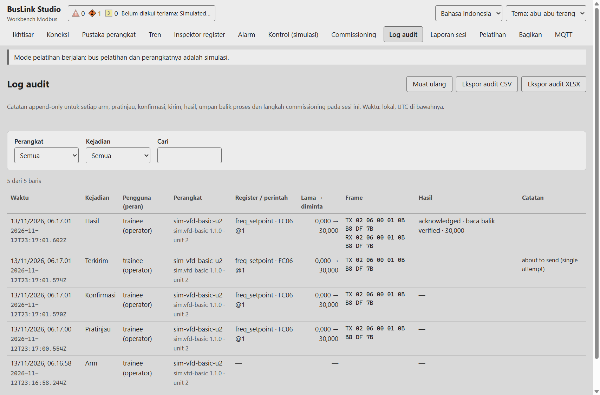

**Log audit** bersifat append-only (hanya ditambah). Log ini mencatat waktu (lokal, dengan UTC di bawahnya), kejadian, pengguna dan peran, perangkat, register atau perintah, nilai lama dan yang diminta, frame, hasil, serta catatan. Gunakan **Ekspor audit CSV / XLSX** untuk menyimpannya.

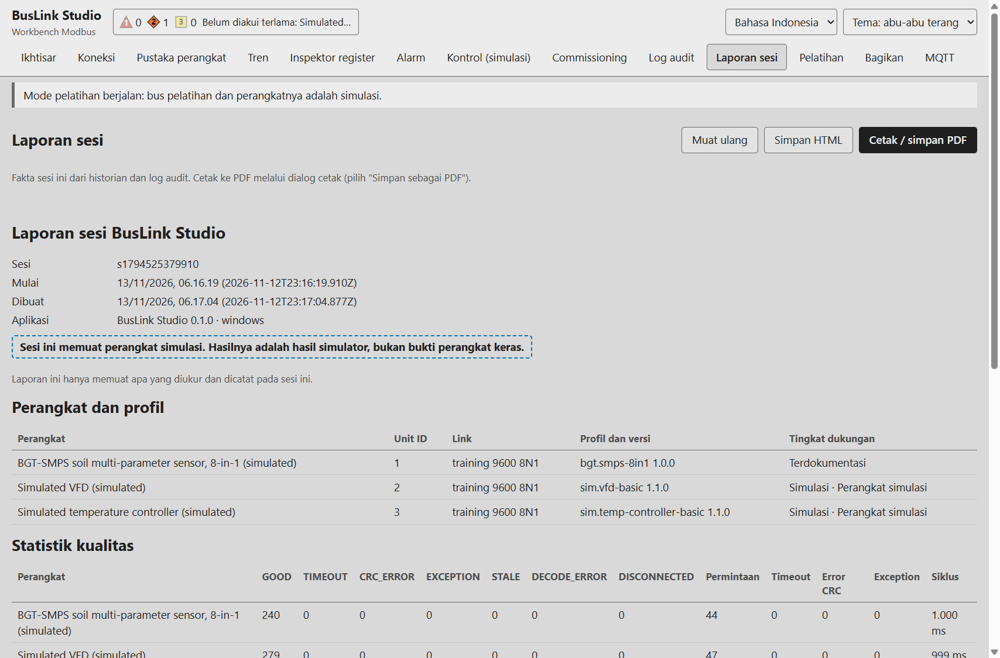

**Laporan sesi** merangkum sesi untuk catatan commissioning. Gunakan **Simpan HTML** atau **Cetak / simpan PDF**.

## 12. Mengekspor data

Di **Ikhtisar**, gunakan **Ekspor CSV**, **Ekspor XLSX**, atau **Ekspor JSON**. Setiap baris berisi:

- waktu dalam format ISO-8601 UTC;
- perangkat dan tag;
- nilai, dengan titik sebagai pemisah desimal;
- **kualitas**, **kode exception**, dan **umur dalam ms**;
- versi profil.

Sel teks yang diawali `=`, `+`, `-`, atau `@` di-escape, sehingga file aman dibuka di aplikasi spreadsheet (injeksi formula dicegah). Di Android, ekspor membuka pemilih file sistem.

## 13. Membagikan dashboard hanya-baca di LAN

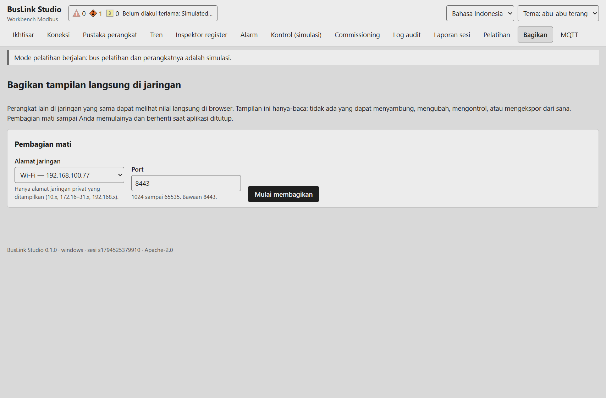

1. Buka **Bagikan**.
2. Pilih **Alamat jaringan**. Hanya alamat privat yang ditampilkan: 10.x, 172.16–31.x, dan 192.168.x.
3. Pilih **Port** (bawaan 8443), lalu tekan **Mulai membagikan**.

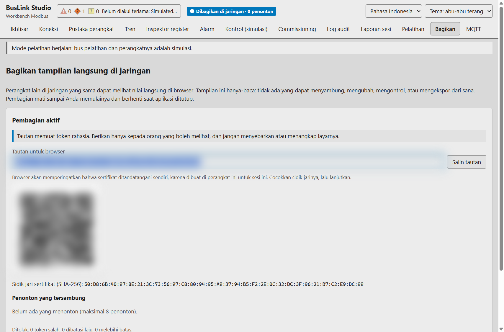

4. Berikan tautan atau kode QR hanya kepada orang yang boleh memantau. Tautan berisi token rahasia yang berlaku untuk satu sesi.
5. Browser mereka akan memperingatkan bahwa sertifikatnya *self-signed*, karena sertifikat dibuat untuk sesi ini. Mereka sebaiknya mencocokkan sidik jari SHA-256 dengan yang tampil di layar Anda, lalu melanjutkan.

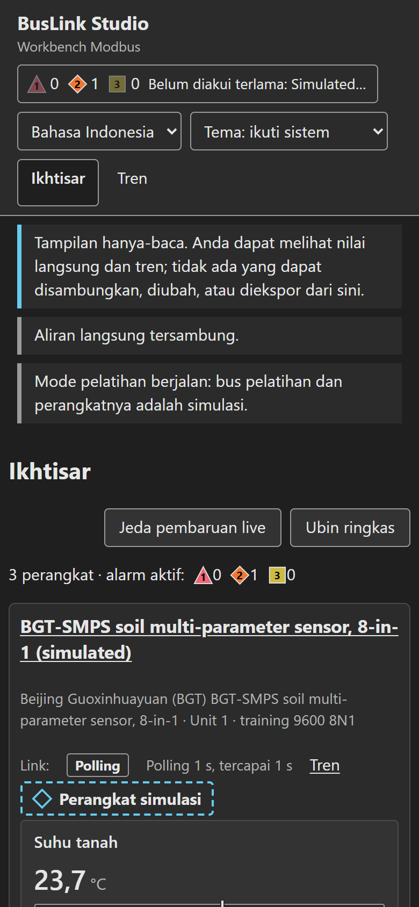

Tampilan yang dibagikan **tidak memiliki tombol koneksi, arm, tulis, atau ekspor**, dan server hanya menerima permintaan GET. **Berhenti membagikan** menutup semua koneksi. Saat berbagi dimulai lagi, token dan sertifikat baru dibuat, sehingga tautan lama tidak berlaku lagi.

## 14. Telemetri MQTT

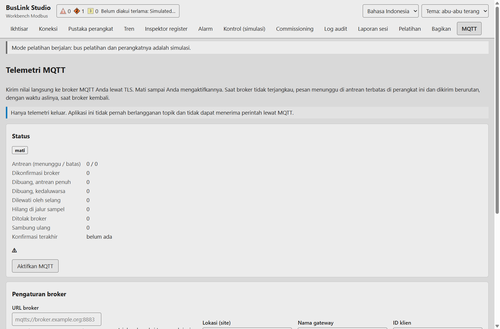

BusLink dapat mengirim nilai ke broker MQTT 5 untuk SCADA, historian, atau cloud.

1. Isi **URL broker** (`mqtts://host:8883`), **Lokasi (site)**, **Nama gateway**, dan **ID klien**. Jangan masukkan nama pengguna atau kata sandi ke dalam URL.
2. Isi **Nama pengguna** dan **Kata sandi** bila broker memerlukannya. Di Windows, kata sandi disimpan di Credential Manager dan tidak pernah ditulis ke file, log, atau ekspor. Di Android, kata sandi saat ini hanya disimpan di memori, dan panel menyebutkannya.
3. Tekan **Uji koneksi**, lalu **Simpan pengaturan** dan **Aktifkan MQTT**.

Topik: `buslink/{site}/{gateway}/{device}/{tag}`. Payload: `{ts, seq, value, unit, quality, profile_version}`.

Ada juga topik `status` yang di-retain, dengan pesan last-will `offline`. Pesan dikirim dengan QoS 1 dan masa kedaluwarsa. Bila broker tidak terjangkau, pesan menunggu di antrean terbatas di perangkat dan dikirim ulang berurutan dengan waktu dan nomor urut aslinya. Penerima sebaiknya menghapus duplikat berdasarkan `(session, seq)`.

**Hanya telemetri keluar.** Aplikasi tidak pernah berlangganan topik dan tidak dapat menerima perintah lewat MQTT.

## 15. Mode pelatihan dan latihan terpandu

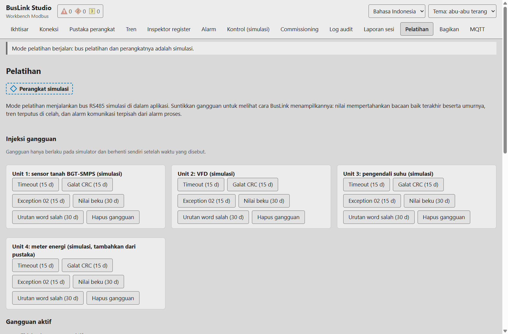

**Injeksi gangguan** hanya berlaku pada simulator, dan setiap gangguan berakhir sendiri setelah waktu yang tertulis.

| Gangguan | Yang akan terlihat |
|---|---|
| Timeout | Badge TIMEOUT, nilai dicoret, celah di tren, alarm komunikasi |
| Galat CRC | Kualitas CRC_ERROR; frame menampilkan balasan yang rusak |
| Exception 02 | EXCEPTION 02 (Illegal Data Address) |
| Nilai beku | Balasan tetap GOOD tetapi nilai berhenti berubah, seperti gateway yang menyajikan cache |
| Urutan word salah | Nilai 32-bit menjadi salah; bandingkan keempat urutan di inspektor |

**Latihan terpandu:**

1. **Membaca tiga perangkat.** Catat satuan, kualitas, dan umur di setiap ubin.
2. **Mengenali celah timeout.** Balasan yang hilang tidak pernah menjadi 0.
3. **Memeriksa urutan word.** Pilih urutan dari manual, bukan dari nilai yang tampak masuk akal.
4. **Data beku.** Kualitas GOOD menggambarkan balasan, bukan kondisi proses.
5. **Mengakui dan menunda.** Diakui tidak berarti pulih, dan penundaan ada masa berlakunya.
6. **Mengekspor catatan.** Temukan baris TIMEOUT di file CSV hasil ekspor.

## 16. Tata letak ponsel dan tema

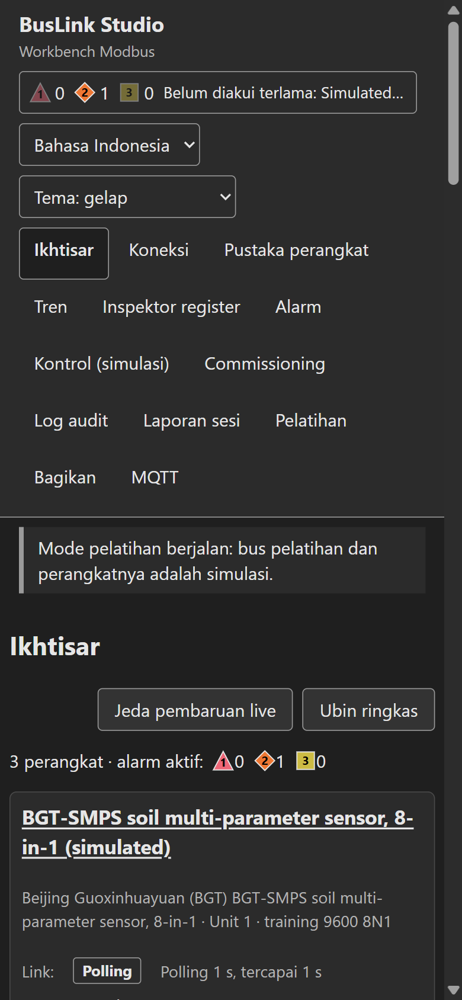

Tata letak tetap berfungsi hingga lebar 360 px. Tema yang tersedia: ikuti sistem, abu-abu terang, dan gelap. Bahasa yang tersedia: English dan Bahasa Indonesia.

## 17. Pemecahan masalah

| Gejala | Kemungkinan penyebab | Yang diperiksa |
|---|---|---|
| Semua tag TIMEOUT | Unit ID, baud, atau parity salah; A/B tertukar; tidak ada daya; ada master lain di bus | Pengaturan dibanding manual; tukar A/B; ukur catu daya; tutup aplikasi lain |
| EXCEPTION 02 | Alamat register tidak ada di perangkat | Alamat dokumen vs offset PDU di inspektor; selisih satu di manual (40001 = offset 0) |
| EXCEPTION 01 | Perangkat tidak mendukung kode fungsi itu | FC03 vs FC04 di profil |
| Sesekali CRC_ERROR | Derau, terminasi tidak ada, cabang kabel terlalu panjang, GND tidak tersambung | 120 Ω di kedua ujung; twisted pair; kabel GND; adaptor terisolasi |
| Nilai 32-bit sangat besar atau sangat kecil | Urutan word salah | Bandingkan empat urutan di inspektor dengan manual |
| Nilai meleset 10× atau 100× | Skala di profil salah | Skala dan desimal dibanding manual |
| Nilai GOOD tetapi tidak pernah berubah | Gateway menyajikan cache, atau sensor beku | Umur dan tren; diagnostik perangkat itu sendiri |
| STALE | Polling berhenti, atau interval polling terlalu panjang untuk batas basi | Status link; interval polling |
| Port serial tidak muncul | Driver, kabel, atau adaptor sedang dipakai aplikasi lain | Device Manager; muat ulang port |
| Android: dialog izin tidak muncul | Filter tidak cocok, atau izin pernah ditolak | Cabut lalu colokkan lagi adaptor; pilih BusLink dan "Gunakan secara default" |
| Penonton LAN tidak bisa membuka tautan | Subnet berbeda, firewall, client isolation di AP, atau token sudah berganti | Wi-Fi yang sama; dialog firewall Windows; mulai berbagi lagi dan kirim ulang tautan |

# Bagian B · Referensi teknis

## 18. Arsitektur

```
src (UI TypeScript, tanpa framework) ─── IPC Tauri ───┐
                                                      ▼
src-tauri (shell Tauri 2) ── perintah, state, share, jembatan Android
          │
          ▼
crates/buslink-core  ── protokol (codec RTU/TCP, CRC) · penjadwal polling
                       kualitas & alarm · historian (SQLite) · tren
                       layanan perintah (satu-satunya jalur tulis) · ekspor
                       server LAN (axum, TLS) · MQTT (rumqttc, outbox)
crates/buslink-sim   ── simulator multi-perangkat dengan injeksi gangguan
plugins/tauri-plugin-buslink-usb ── Kotlin: usb-serial-for-android,
                       alur izin, foreground service connectedDevice
```

- **Satu inti, tiga wajah.** Aplikasi Windows, aplikasi Android, dan tampilan LAN memakai inti Rust yang sama dan UI hasil build yang sama. Tampilan LAN adalah UI itu dalam mode hanya-baca.
- **State sesi ada di Rust.** Memutar ponsel atau activity yang dibuat ulang tidak memutus koneksi dan data.
- **Trait transport.** Serial (Windows), USB (Android, dengan buffer agar paket USB yang terpecah tidak merusak framing RTU), TCP, dan simulator semuanya mengimplementasikan satu trait yang sama.

## 19. Detail protokol

- Framing RTU memakai jeda antar-frame t3.5 (tetap 1,75 ms di atas 19 200 baud), minimal 5 ms.
- Timeout respons bawaan adalah waktu permintaan ditambah jawaban terpanjang di kabel ditambah 300 ms waktu olah perangkat, minimal 500 ms.
- CRC-16/MODBUS. Vektor uji `01 03 00 00 00 08 44 0C` membaca 8 holding register dari unit 1.
- Batas baca: 125 register atau 2000 bit per permintaan. Tag yang berdekatan digabung menjadi satu pembacaan bila jaraknya memungkinkan. Satu tag tidak pernah dipecah.
- Link Android menunggu minimal 50 ms antar-frame.

## 20. Model kualitas dan waktu

Setiap sampel membawa `quality`, `value`, `value_ts` (waktu nilai terakhir kali baik), `age_ms`, dan kode exception. Aturannya:

1. Pembacaan yang gagal tidak pernah menghasilkan nilai baru. Nilai baik terakhir disimpan bersama waktu aslinya dan ditandai dengan kualitas yang baru.
2. STALE ditentukan oleh umur: umur > maks(3 × interval polling, 3 detik).
3. Tren dan ekspor membawa label kualitas di setiap titik. Garis tren terputus di setiap titik yang tidak GOOD.
4. Saat link diputus, aplikasi menunggu hingga 1 detik untuk sampel yang sudah terkirim, lalu menandai semua tag DISCONNECTED. Ini adalah race condition nyata yang ditemukan dan diperbaiki selama pengembangan.

## 21. Jalur tulis dan aturan keselamatan

Seluruh pengodean FC05, FC06, FC15, dan FC16 ada di `crates/buslink-core/src/command/`. Sebuah hook Kiro memblokir kode fungsi tulis, frame tulis mentah, dan unit ID 0 di tempat lain. Layanan perintah menegakkan aturan berikut:

| Aturan | Mekanisme |
|---|---|
| Tidak ada pengiriman tanpa arming | `ensure_armed` diperiksa saat pratinjau, konfirmasi, dan eksekusi; arming punya masa berlaku |
| Tidak ada pengiriman tanpa konfirmasi | `execute` mensyaratkan status Confirmed; objek frame habis dipakai oleh `send` |
| Tidak pernah dua kali | Eksekusi kedua gagal dengan `WrongState`; tidak ada retry di mana pun dalam modul |
| Tidak pernah broadcast | Unit 0 ditolak sebagai `BroadcastRejected` |
| Batas | Ditolak, tidak pernah dipotong: min/maks/step/nilai yang diizinkan/rentang valid; nilai tidak hingga ditolak |
| Audit lebih dulu | Bila baris audit gagal ditulis, tidak ada yang dikirim (fail-closed) |
| Hanya simulasi | Kontrol mensyaratkan penanda link simulator milik sesi itu sendiri; link loopback manual hanya untuk pemantauan |
| Stop perangkat lunak | Diberi label "Bukan emergency stop" |

## 22. Format profil perangkat (skema v1)

Profil adalah file JSON di folder `profiles/`. Skemanya ketat dan profil **tidak berisi skrip maupun ekspresi**. Bagian utamanya:

- **Tingkat atas:** `profile_id`, `profile_version`, `vendor`, `model`, `support_level`, `simulated_only`.
- **`transport`:** pengaturan serial bawaan.
- **`registers`:** satu entri per register.
- **`commands`:** hanya untuk perangkat simulasi di v1.
- **`comm_config`:** register yang dipakai wizard commissioning.

Contoh register:

```json
{
  "id": "freq_setpoint",
  "name": { "en": "Frequency setpoint", "id": "Setpoint frekuensi" },
  "table": "holding_register",
  "address": 1,
  "type": "u16",
  "scale": 0.01,
  "unit": "Hz",
  "decimals": 2,
  "valid_range": [0, 50],
  "access": "read_write",
  "write": { "min": 0, "max": 50, "step": 0.01, "risk": "medium", "role": "operator" }
}
```

- `table`: `coil`, `discrete_input`, `holding_register`, atau `input_register`.
- `address`: offset PDU berbasis nol.
- `type`: misalnya `u16`, `i16`, `u32`, `i32`, atau `f32`, dengan urutan word untuk tipe 32-bit.
- `display_range`: opsional, hanya dipakai untuk bar analog. Tidak pernah memengaruhi dekode.

Profil di atas 1 MB, kunci duplikat, dan kolom yang tidak dikenal ditolak saat dimuat. Skema lengkap ada di `docs/profiles/schema-v1.md` dan `profiles/schema/buslink-profile.schema.json`.

## 23. Desain keamanan

| Area | Desain |
|---|---|
| Aplikasi desktop | Capability Tauri hanya `core:default`; CSP ketat; tidak memuat konten remote; rendering hanya teks (tanpa `innerHTML`) |
| Server LAN | Nonaktif secara bawaan; hanya IPv4 privat (menolak 0.0.0.0, IPv6, dan alamat publik); port ≥ 1024; sertifikat rcgen per sesi; token 128-bit yang dibandingkan dalam waktu konstan; token hanya diterima di `GET /`, lalu diganti cookie `Secure; HttpOnly; SameSite=Strict`; hanya GET, body permintaan ditolak; pembatasan laju dengan penguncian setelah 5 kegagalan; 32 koneksi, 4 per alamat, 8 yang belum terautentikasi |
| MQTT | TLS secara bawaan (root sistem ditambah CA opsional); kredensial tidak pernah di URL, file, atau log; tanpa langganan topik; outbox terbatas |
| Android | Service tidak diekspor; tanpa izin penyimpanan; ekspor file lewat pemilih sistem; izin USB satu permintaan per waktu dengan timeout 60 detik |
| Build rilis | Pemeriksa menggagalkan build bila kode khusus tes (`e2e`) masuk ke installer |

Agen Kiro hanya-baca meninjau kode terhadap IEC 62443-4-2 dan OWASP. Hasilnya 0 kritis, 0 tinggi, 2 sedang, dan 6 rendah. Kedua temuan sedang dan tiga temuan rendah sudah diperbaiki dengan tes. Sisanya diterima dengan alasan tertulis di `docs/security/review-07-fixes.md`.

## 24. Verifikasi

| Pemeriksaan | Hasil |
|---|---|
| `cargo test --workspace` | 274 lulus (termasuk property-based test dengan seed; setiap kegagalan mencetak seed untuk diulang) |
| `npm test` | 37 lulus |
| Alur 1: dashboard, timeout, celah tren, ekspor | 15/15 |
| Alur 3: berbagi LAN, token, hanya-baca, berhenti | 38/38 |
| Alur 4: arm, konfirmasi, baca balik, audit | 30/30 |
| Installer Windows: pasang senyap, jalankan, copot | lulus |
| Ponsel Android dengan sensor nyata | **belum dijalankan** |

Semua alur dijalankan pada aplikasi Windows yang sebenarnya dengan simulator. Rinciannya ada di `docs/verification/README.md`.

## 25. Batasan yang diketahui

- Kontrol dibatasi pada perangkat simulasi di v1.
- Build Android belum diuji di ponsel dengan sensor nyata. Penyimpanan kata sandi MQTT di Android Keystore belum diimplementasikan.
- Tidak ada login: aplikasi ini adalah alat lokal untuk satu pengguna, dan peran berfungsi sebagai interlock.
- Stop perangkat lunak bukan emergency stop. BusLink bukan perangkat lunak bersertifikat keselamatan.
- Installer Windows belum ditandatangani (code signing).

## 26. Lisensi dan kredit

Apache-2.0. Pustaka pihak ketiga tercantum di `THIRD_PARTY_NOTICES.md`, dan karya yang sudah ada sebelumnya diungkapkan di `docs/existing-code-disclosure.md`. Dibangun untuk Kiroween 2026 dengan Kiro: 7 spec, 60 tugas, dan 12 sesi Kiro CLI yang tercatat.
