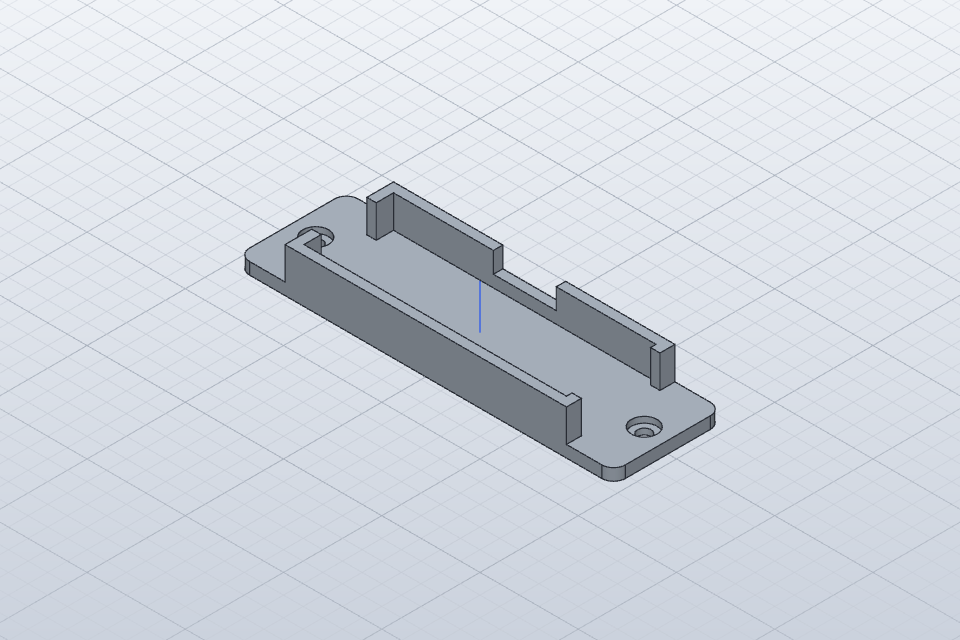

# USB-RS485 adapter holder (SolidCraft)

A printable cradle for the Waveshare-style **USB TO RS485 (B)** adapter (CH343G). It keeps the adapter in place on a bench, a panel or a DIN-rail mounting plate, so the screw terminals don't take cable strain.

| File | Use |
|---|---|
| `rs485-adapter-holder.sc` | SolidCraft source (parametric) |
| `rs485-adapter-holder.step` | CAD exchange |
| `rs485-adapter-holder.stl`, `.3mf` | 3D printing |

- **Parameters:**
  - `aL`, `aW`, `aH`: the adapter body, assumed to be **66 × 22 × 11 mm**. **Measure your unit and change these first.**
  - `clr` = 0.4 mm clearance, `wall` = 2.4 mm, `base` = 3 mm.
- **Features:**
  - An open pocket, 75 % of the body height.
  - An opening at the USB-plug end.
  - An opening at the terminal end, so A+/B−/GND stay reachable.
  - A finger notch on the side for removing the adapter.
  - Two tabs, each with an M3 counterbored hole (3.4 mm through, Ø6.5 × 1.5 mm).
- **Size:** 95.6 × 27.6 × 11.25 mm overall. The volume is 10.63 cm³, and SolidCraft `measure` agrees with the hand calculation.
- **Printing:** PETG or ASA for panel use, 0.2 mm layers, 3 walls. No supports are needed, because the openings face upward.

The adapter dimensions are an assumption: the Waveshare pages could not be fetched, so they do not come from a datasheet. The board is **not isolated** (see `research/03`). For field work on long or noisy buses, use an isolated adapter.
